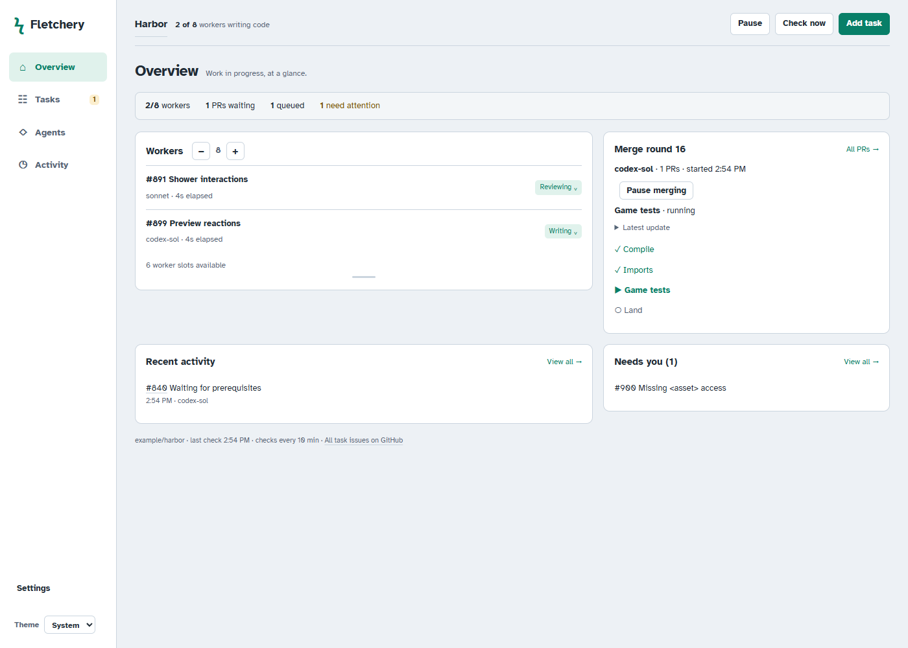
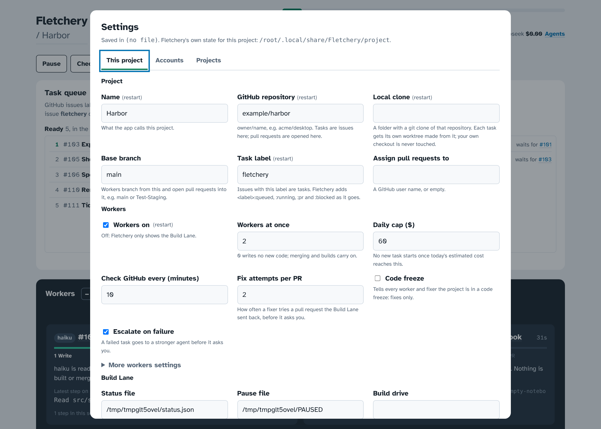
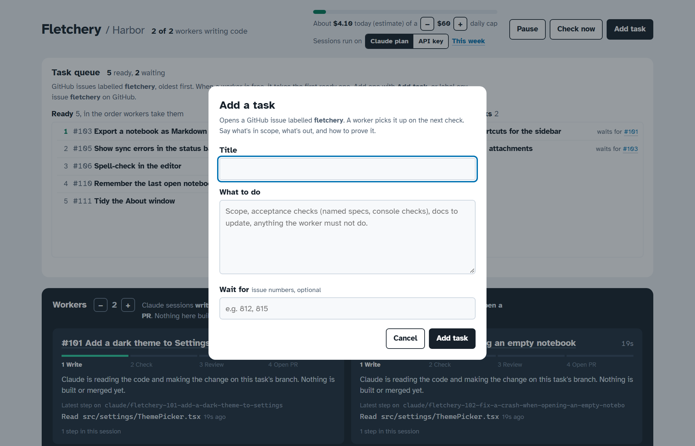
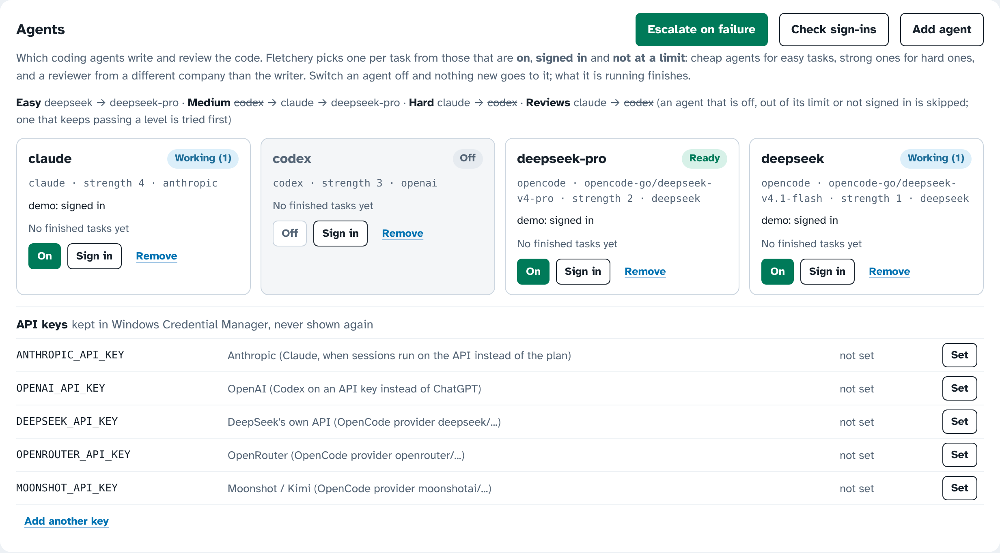
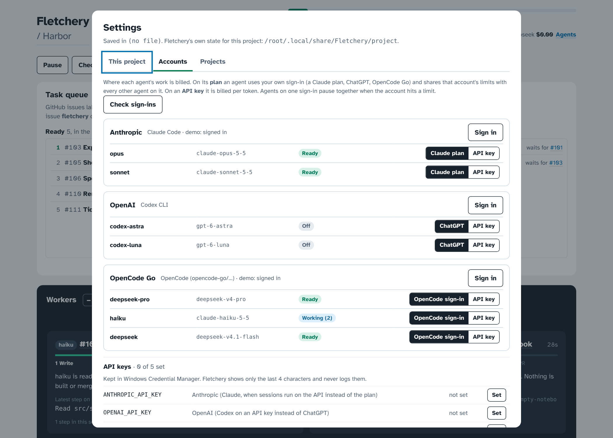
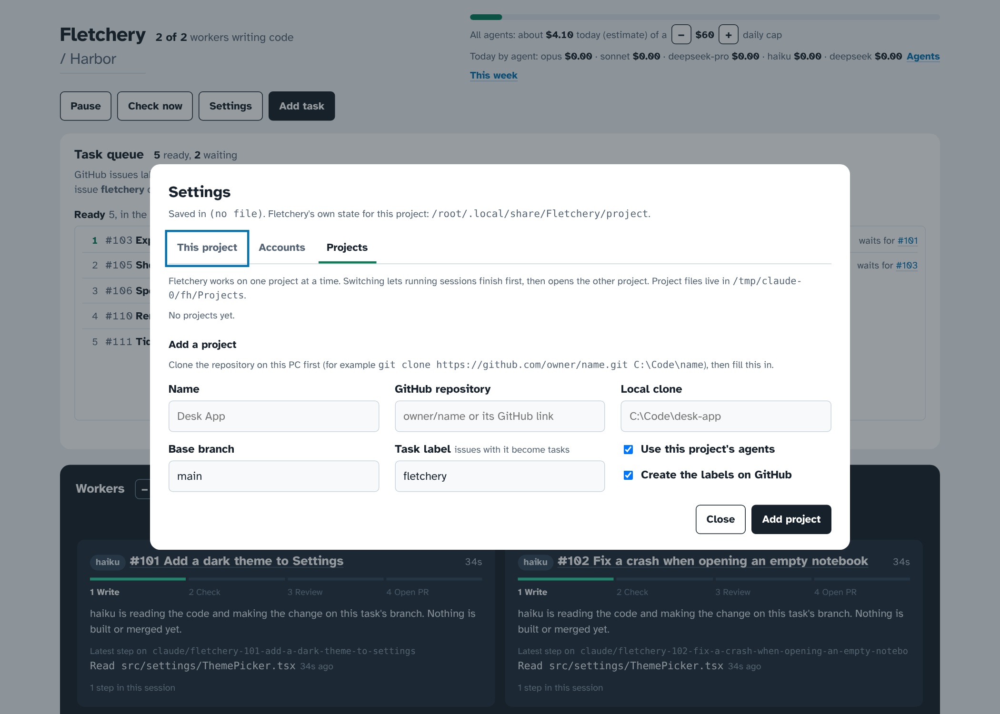
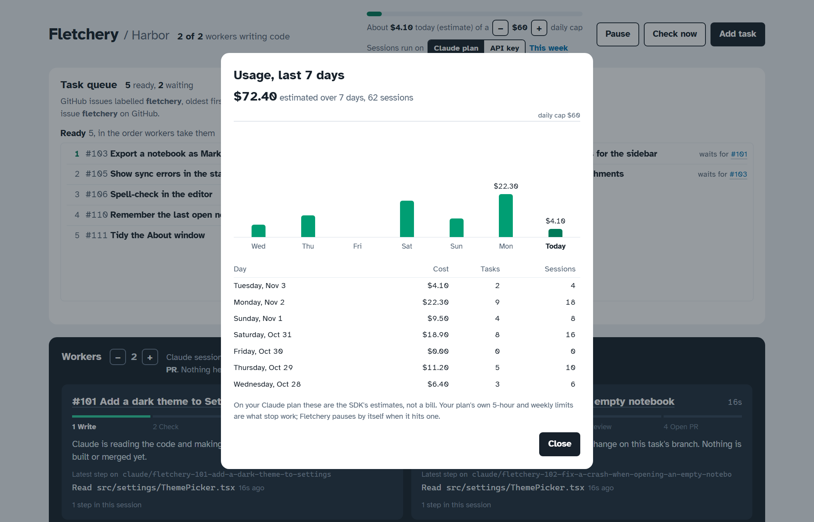

<p align="center">
  
</p>

<h1 align="center">Fletchery</h1>

<p align="center"><strong>Turn GitHub issues into finished, tested pull requests while you do something else.</strong></p>

Fletchery is a Windows app for one person and a team of AI coding agents (Claude, Codex, DeepSeek and others through
OpenCode). You write what you want as GitHub issues. An agent writes each change on its own branch, Fletchery checks
it, an agent from a different company reviews it, and it becomes a pull request. Your build lane then builds, tests
and merges it. One window shows all of it, and nothing merges without passing your checks.

Workers and fixers that report heavy-work reservation contention keep their existing branch and resume after the lease is released. Waiting survives an app restart and does not consume repair attempts; permission denials remain failures. The controller never releases another job's lease. Asset workers use task-owned Blender MCP profiles to isolate background jobs from shared startup scenes, and verify a bounded probe before claiming recovery.

**All workers** now allocates writing capacity across baseline strength ranks: low (<60), medium (60–74) and high (75+) using eligible ready tasks. Each rank can instead be set manually from 0–10; changing All workers (0–30) restores automatic allocation. Rank sections show baseline scores, restrictions and ready task levels. Task badges record the bucket used when work was admitted. Dashboard refreshes preserve the reader’s scroll position. Existing task eligibility, reviews, escalation and emergency repair policy remain in force.

**Pause & hand off** stops new dispatch and saves active work at the next safe phase boundary. It stages the task changes, records the checkout and notes, and lets an eligible agent continue on Resume without skipping checks.

**Merge windows & packages** queues durable, cancellable integration requests. Future windows leave feature work running; due windows drain active sessions and validate the selected PR heads before reserving capacity. Package requests name an exact revision or depend on a selected window, and use the existing staging release controller for full tests and verified artifact results. The dashboard groups active, blocked, and upcoming requests, with expandable PR lists and a collapsed history for finished and cancelled requests. A quota pause on one account leaves other signed-in accounts eligible even when their worker slots are full. Queues survive restart and uncertain dispatches are not resent. [Operating guide](docs/WORK-MERGE-PACKAGE.md).

The Control room keeps live workers and merge progress on **Overview**, with separate
**Merge & build**, **Tasks**, **Agents** and **Activity** views. Expand a worker row for its latest step, or a merge step for check results, activity and logs.
When merging has priority, the Workers panel and status banner explain why new coding waits, show the current merge step, and confirm automatic resumption.
Paused merging and interrupted rounds awaiting authorization leave feature capacity available, including while cleanup finishes. Active rounds retain their reservation. See [work, merge and package policy](docs/WORK-MERGE-PACKAGE.md) for the operating plan.
Merge progress is read from the local progress file on every dashboard refresh, independently of scheduler and GitHub polling. A failed required merge check stays prominent even when another step reports activity. The panel explains that landing is blocked until the failing PRs are repaired or excluded and affected checks pass on the remaining candidate; merge agents reset affected checks after changing that candidate.
Open Tasks for dependencies, PRs and build details. Settings, Pause and Add task stay
available across views. Choose **System**, **Light** or **Dark** in the sidebar; your
theme and last view are remembered on this machine.




<sub>Every screenshot here is the real app showing a made-up project, "Harbor". See [where the pictures come from](#where-the-pictures-come-from).</sub>

**Jump to:** [How it works](#how-it-works) · [Install](#install) · [First ten minutes](#first-ten-minutes) ·
[Everyday tasks](#everyday-tasks) · [Coding agents](#coding-agents) · [Add another project](#add-another-project) ·
[Settings](#settings) · [Costs and limits](#costs-and-limits) · [Project rules](#project-rules) ·
[Something looks wrong](#something-looks-wrong) · [For developers](#for-developers)

## How it works

```
 GitHub issues ──▶ Workers ──────────────────────────────▶ Pull request ──▶ Build Lane ──▶ merged
 (your tasks)     an agent writes it, Fletchery checks it,        ▲         builds and tests
                  another company's agent reviews it              │         on your PC
                                                                  └── fixer ◀── sent back
```

| Part | What you see | What it does |
|---|---|---|
| **Task queue** | Issues with the project's label, oldest first, the next one marked | Waits for a free worker. A task that says `Depends on: #12` waits until #12 is done |
| **Workers** | Each worker's task, which agent has it, its step (write, check, review, open PR) and the last thing it did | Agent sessions writing code on their own branches. They never build, merge or touch your other work |
| **Workers' PRs** and **Needs you** | The pull requests workers opened, and tasks that stopped for a decision | A PR the lane sends back goes to a fixer automatically, twice at most; after that it asks you |
| **Agents** | Each provider (Anthropic, OpenAI, OpenCode Go…) and its models, with scores and status | Picks the cheapest agent good enough for each task, and switches agents on or off |
| **Build Lane** | What is building, which step, how far, and the PRs waiting | Your own build machine, as before. Fletchery shows it and can pause it |

<p>
  
</p>

## Install

**You need:** Windows 10 or 11, [Python 3.10 or newer](https://www.python.org/downloads/) (tick *Add python.exe to PATH*),
[Git](https://git-scm.com/download/win), the [GitHub CLI](https://cli.github.com/) signed in (`gh auth login`), and at
least one coding agent signed in: [Claude Code](https://docs.claude.com/en/docs/claude-code/overview) (run `claude`,
then `/login`), the Codex CLI (`codex login`) or [OpenCode](https://opencode.ai) (`opencode auth login`). Microsoft Edge's WebView2, which draws the window, is already part of Windows 10 and 11.

1. **Get the code:** clone this repository, or use **Code → Download ZIP** and extract it.
2. **Run the installer** in Windows PowerShell, in the repository folder:

   ```powershell
   powershell -NoProfile -ExecutionPolicy Bypass -File .\shell\Install-Fletchery.ps1
   ```

   It builds `Fletchery.exe` with the compiler that comes with Windows, installs the Claude Agent SDK for Python if it
   is missing, copies the app to `%LOCALAPPDATA%\Programs\Fletchery`, and adds **Fletchery** to the desktop and the
   Start menu. No administrator rights.

3. **Open Fletchery** and fill in your project in **Settings** ([First ten minutes](#first-ten-minutes)). To update later, pull this repository and run the installer again. Fletchery picks up the new
   version between tasks, never in the middle of one.

Development roles use CLI, connected APIs/MCP and isolated browser sessions by default. Desktop apps and existing browsers require an explicit user request; an unavailable allowed route is reported as a blocker rather than replaced with desktop control.

## First ten minutes

**1. Point it at your project.** Clone your repository somewhere on this PC first, for example
`git clone https://github.com/you/harbor.git C:\Code\harbor`. Then open **Settings** and fill in **This project**:

- **GitHub repository**: `owner/name`, or paste its GitHub link.
- **Local clone**: the folder you just cloned to. Fletchery makes each task its own worktree from it and never edits
  your checked-out files.
- **Base branch**: where pull requests go, usually `main`.
- **Task label**: issues with this label become tasks (`fletchery` by default).

Press **Check the project** to see that GitHub and the clone line up, then **Save**. Fletchery restarts once to pick
it up. If you have a Build Lane, fill in its status file, pause file and drive under **Build Lane**, and its panel
appears.

<p></p>

<sub>Prefer files? Everything here is saved in a small profile in `%APPDATA%\Fletchery\Projects`. See
[`examples/Example.profile.json`](examples/Example.profile.json).</sub>

**2. Give it a task.** Press **Add task** (or label any issue `fletchery` on GitHub). Write it like you would for a
colleague: what to change, what not to touch, and how to tell it worked.

<p></p>

**3. Watch it.** Within a minute a worker takes it. The **Workers** section shows its step and the file it is working
on; when it is done, a pull request appears under **Workers' PRs**, and Windows tells you.

**4. Steer it.** Comment on the task's issue: every worker reads the issue and all its comments before it starts. If a
task lands under **Needs you**, its issue says what it needs; answer in a comment, then change its label from
`fletchery:blocked` to `fletchery:queued`.

## Everyday tasks

| I want to… | Do this |
|---|---|
| Add work | **Add task**, or label an issue on GitHub. `Depends on: #12` in the description makes it wait for #12 |
| Stop new work for a while | **Pause** (top right). Workers already running finish; nothing new starts until **Resume** |
| Run more or fewer workers at once | **−** / **+** next to *Workers* (0 to 10) |
| Stop new code but keep merging and building | Turn *Workers* down to **0**. Running sessions finish; the Build Lane carries on |
| Spend less | **−** next to the daily cap. At the cap no new work starts that day |
| See this week's usage | **This week** under the cap |
| Switch an agent between its plan and an API key | **Settings > Accounts**, *Runs on* next to the agent (applies to its next session) |
| Use Codex, DeepSeek or another model too | **Add agent** in the Agents panel, then **On** / **Off** per model ([Coding agents](#coding-agents)) |
| See why an agent gets the tasks it does | Open its row in the Agents panel for its scores |
| Send one task to a particular agent | An `agent:<name>` label, or `Agent: <name>` on its own line in the issue |
| Store an API key for an agent | **Settings > Accounts > API keys** (kept in Windows Credential Manager) |
| Sign an agent in again | **Settings > Accounts**, **Sign in** next to its provider |
| Work on another repository | **Settings > Projects** ([Add another project](#add-another-project)) |
| Stop builds on the build PC | **Pause builds** in the Build Lane panel. A build already running finishes |
| Close the window but keep working | Close it. Fletchery stays in the tray; right-click the tray icon to quit |
| Make the task list taller | Drag the handle under the Task queue (or focus it and use the arrow keys) |

## Coding agents

The **Agents** panel groups agents by where they come from: **Anthropic** (Claude Code), **OpenAI** (Codex CLI) and
each OpenCode provider, such as **OpenCode Go** for DeepSeek or Haiku. Each model is one row with its overall score, its
status and an **On / Off** switch.



**How it picks.** Each task gets a kind (C++ / Unreal, Python & tools, UI, Docs & data) and a difficulty (easy,
medium, hard). Each difficulty has a bar. The cheapest agent that is on, signed in, not at a limit and scores above the
bar gets the task. The review goes to the best reviewer from a different company than the writer. If an agent fails,
the task moves up to a stronger one before it asks you.

**Where the scores come from.** They start from public coding benchmarks for the model, then move with how the agent
actually does on your tasks. Open a row to see each score and where it came from, and use **Edit scores** to set one
yourself. **Refresh benchmarks** fetches the latest list. To send one task to a particular agent, give its issue an
`agent:<name>` label.

**Adding a model.** Press **Add agent** and type the model (for example `opencode-go/claude-haiku-5-5`). The name,
company and scores fill in by themselves. [Coding agents](docs/AGENTS.md) has the details.

**Accounts.** Sign-ins, plan or API key, and API keys are in **Settings > Accounts** (or **Accounts & keys** on the
panel). Models on one sign-in share its limits, so when OpenCode Go hits its limit, all its models pause together and
the others carry on.

<p></p>

## Add another project

Fletchery works on one project at a time and remembers all of them.

1. Clone the new repository on this PC, for example `git clone https://github.com/you/desk-app.git C:\Code\desk-app`.
2. Open **Settings > Projects** and fill in **Add a project**: a name, the repository, the clone folder, the base
   branch and the task label.
3. Press **Add project**. Fletchery checks that GitHub and the clone match, and creates the task labels on GitHub
   (`fletchery`, `fletchery:queued`, `:running`, `:pr`, `:blocked`). The new project starts with one worker and a $20
   daily cap, and can copy your agents.
4. Press **Switch to it**. Running sessions finish first, then Fletchery opens the other project. Switch back the same
   way.

<p></p>

Optional: give the repository a `.fletchery/` folder with its own rules ([Project rules](#project-rules)).

## Settings

**Settings** (top of the window) has three tabs:

| Tab | What's there |
|---|---|
| **This project** | Repository, clone, base branch, label; workers at once, daily cap, how often to check GitHub, fix attempts, code freeze, escalation; the Build Lane's files. Less common settings sit under *More…*. A setting marked *(restart)* applies after Fletchery restarts, which it offers to do |
| **Accounts** | Each provider's sign-in, whether each agent runs on its plan or an API key, and the API keys |
| **Projects** | Your projects, **Switch to it**, and **Add a project** |

## Costs and limits

- **On a plan** (the default), each agent uses your own sign-in: your Claude plan, ChatGPT for Codex, or OpenCode Go.
  Its usage counts against that plan's limits, and the amounts Fletchery shows are estimates, not a bill. When a limit
  is reached, that agent (and every model on the same sign-in) pauses by itself, and its task goes back in the queue
  with its work kept.
- **On an API key**, store the key in **Settings > Accounts** and switch that agent's *Runs on* to **API key**.
  Sessions are billed per token, and the amounts shown are what they cost.
- Two guards apply either way: a **daily cap** (no new work after it) and a **per-session budget**. If a sign-in
  expires, that agent pauses and its provider shows **Not signed in · sign in**.

<p></p>

A limit on one account pauses only the agents on it, and their tasks go to the others.

## Explicit asset tasks

Workers remain text-only by default. An operator can authorize an individual local art task in the project
profile's `workers.assetTasks`, keyed by issue number, for example
`"991": {"paths": ["Art/Characters/Hair/", "Review991/"]}`. Only an immediate task checkout under the configured
worktree root receives this grant. Codex authoring sessions need local tool access; reviewers and planners retain
read-only access. The grant is operator configuration, never inferred from issue text or worker files.

Authorized LFS additions and updates publish through the project's existing `Tools/CI/PushWithLfs.ps1` helper;
missing helpers or failed uploads stop publication. Delivery runs outside the controller event loop for both
workers and fixers. Repairs validate their delta against the original PR head and retain ownership, ancestry and
remote-head guards. Every changed LFS path must be listed, including both sides of a rename. A `"mode": "delete"`
grant permits deletions only and uses the normal Git LFS hook. Reviewers still assess correctness and required
Build Lane evidence; authorized binary files alone do not trigger escalation. Use official Blender Lab MCP for
Blender work and preserve other workers' scenes. Remove grants when the tasks finish.

## Project rules

All agent roles carry the [Blender Lab MCP requirement](docs/BLENDER-MCP.md): use the
official MCP for Blender work, inspect scene ownership first, and report connection
blockers instead of falling back to desktop control or direct Blender launches.

Each project can tell its workers how it likes things done, in a `.fletchery/` folder in its own repository:

| File | What it does |
|---|---|
| `conventions.md` | Read by every worker, reviewer and fixer: naming, style, what not to touch |
| `gates.json` | The quick checks Fletchery runs on every change, chosen by which files changed |
| `worker.md`, `reviewer.md`, `fixer.md` | Extra notes for that role |
| `merger.md` | How a merge round builds, imports and tests (see Merge rounds below) |

[Writing project rules](docs/WORKERS.md) has examples. With no rules, workers follow the code around them, and the
reviewer and your Build Lane still check the result.

## The Build Lane

If you run a build machine (the [local runner](runner/README.md), or your own CI writing a small status file), Fletchery
shows it under the workers: what is building, which step, how far, and the PRs waiting their turn. Pull requests from
workers are marked.


Releases, the integration mode, timing history and merge controls are still in the classic BuildLane app for now
([its guide](docs/BUILDLANE-CLASSIC.md)); they are moving into Fletchery next.

## Keeping disk use under control

New text-only task checkouts omit binary Art/Content files while keeping source, manifests and text data. Explicit asset tasks and merge candidates keep full files; existing workspaces are not shrunk. Settings > Storage can turn this off for projects whose worker checks need those binaries. Granting an existing small checkout an asset task expands it without cleaning or resetting user work.

Automatic cleanup checks safe idle opportunities hourly, retaining completed task copies for 24 hours by default. It only retires ordinary task checkouts whose issue is verified closed and whose exact commit is contained in the verified remote base. Dirty, staged, untracked and unique ignored files, active or preserved attempts, all merge candidates and saved recovery checkpoints stay in place. Source-backed Python caches are regenerable. Hydrated LFS payloads require a matching verified object in the retained shared store. Branches and Git/LFS objects are never pruned.

The Workers area shows cleanup status and **Clean eligible copies** queues a safety-checked pass without the age delay. Global Pause, active app jobs and heavy reservations defer cleanup. It runs outside the scheduler, at most ten checkouts per pass, and draining waits for an active cleanup to finish. Full receipts are in `storage-cleanup.json`. Logical bytes removed are reported separately from actual volume free space. Controls are `workers.autoCleanup`, `cleanupRetentionHours` and `thinTextWorkers`.

## Emergency workers

A separate **Emergency workers** control reserves **0 or 1** extra slot for build and merge repairs. It defaults to 1 and applies immediately without a restart. Normal Workers at 0 pauses feature work while this slot can fix failed build checks, merge conflicts, excluded PRs and recorded merge failures. Ordinary feature tasks cannot use it. Turning Emergency workers to 0 stops new emergency sessions; existing sessions finish.

Emergency repairs use the existing branch, review and validation rules. Their required prerequisites and bounded blocker planning can use the same single slot. They still respect global Pause, draining/restarts, daily budgets, provider availability, repair limits and heavy-work reservations; they never release another job's reservation. Real decisions and exhausted repairs remain visible in Needs you. A merge failure creates a deduplicated diagnostic repair issue; filing it is not proof that the underlying cause was fixed.

The profile setting is `workers.emergencyWorkers` (0 or 1). Settings and the dashboard report normal and emergency sessions separately.

## Merge progress

Open **Merge & build** for the current round's expandable steps, individual check results, elapsed times, recent activity and output files. The active step opens automatically; your expansion and detail-tab choices survive status refreshes. The overview keeps a compact version of the same panel. Both light and dark themes work at narrow window widths.

Merge progress and saved history remain visible even while the GitHub queue is unavailable or still loading. The live summary separates recent log activity from a checkpoint update, shows completed steps and the next action, and keeps previous attempts collapsed. Missing telemetry is shown as not reported; quiet output is a warning to inspect activity, not proof of a hang. Failed required checks block landing even while another step reports activity. Machine reservations and pending app updates have their own context cards. Update messages distinguish an active merge from worker sessions draining after a round ends.

On Windows, the dashboard listener and request threads receive ordinary scheduling priority while worker sessions retain their lower priority. This keeps the progress panel responsive during heavy validation without stopping a merge.

Status reads the current checkpoint on each dashboard poll and tails only bounded, approved round logs. **Open full log** serves plain text from the current saved round, capped at the latest 1 MiB with a truncation notice. Step timings and check results are reported only when the runner supplied them; source progress and generated captures do not imply visual acceptance.

## Merge rounds

Recoverable non-operator interruptions automatically queue their saved checkpoint and wait for resources. An operator interruption (including physical Escape during computer control) pauses the saved round until an explicit **Resume saved round / Merge now** request. It does not mark untested PRs broken, consume their repair attempts, or file a code-failure issue. The stop reason remains visible alongside the summary. Confirmed compile/test failures still keep their exact heads excluded, even when another part of the round is interrupted.

An explicitly queued recovery can wait for another project's final acceptance receipt, bound to a unique request id. A short PC-lease gap or stale completion receipt does not start it early. External chat handoffs have a persistent 15-minute deadline with a visible countdown. If the completion signal never arrives, the merger resumes to verify the outstanding evidence directly; expiry never counts as accepted testing. **Merge now** releases that handoff immediately and records the same verification requirement. Explicit pauses, operator stops and native/heavy reservations still apply.

On startup, legacy exclusions that only describe interrupted or incomplete acceptance become deferred; confirmed failures remain excluded. The authenticated local recovery API can adopt an older interrupted candidate after validating its round, branch, full commit and exact deferred PR set. The authenticated recovery API can also reconcile a transport-lost round to its current saved branch/commit: it verifies checkout ownership, progress PRs, live ready heads and included commits, requires head-bound failure evidence for removed PRs, and preserves generated files and acceptance still pending. It cannot use a transport retry to bypass a recorded validation failure.

A saved checkpoint records the real candidate path, branch, full commit, PR heads and completed progress. Resumption waits for the normal PC reservation and verifies checkout registration, ownership, branch and commit without resetting or cleaning generated files. The merger must verify source/content/external-input/binary fingerprints before reusing successful checks and continue only the remaining acceptance; changed inputs require the affected checks again.

Ready merges take priority over normal workers, fixers and prerequisite planners. The independently enabled emergency slot can still repair build/merge failures. Existing jobs finish normally;
when the PC reservation clears, the merger gets the next opportunity. New writing resumes when no eligible
merge is pending or running. Pausing/disabling merging, unresolved dependencies, failed-round cooldowns and
unavailable merger accounts do not hold unrelated writing. A busy merger agent reserves its next free slot.

The Merge & build panel shows the current wait separately from collapsed previous-round results. Finished
rounds have a fixed total duration and do not keep showing their failed steps or PR membership as current.


Merge rounds can use any enabled, signed-in Claude, Codex or OpenCode agent allowed to take the merger role.
The preferred merge agent wins when available; otherwise the best available C++ score wins, regardless of provider.
Each round stops at confirmed validation failures and allows one small repair cycle per implicated PR
(up to 15 minutes of diagnosis/editing). A failed repair leaves that head out; its dependencies wait,
while independent PRs continue. Excluded heads stay out across restarts until changed, and worker PRs
receive bounded fixer feedback. PRs without a worker issue get a repair tracking issue for their existing
branch. New checkouts are created when the previous one is dirty or fails preparation;
failed/dirty content stays in place with recovery diagnostics. Busy/leased checkouts wait untouched.

LifeShare rounds use final-diff test selection, fail-fast preflight and memory-aware concurrency when
its runner supports them. Full nightly/release validation and project acceptance checks remain required.
Only one round runs at a time. Merger sessions have the local and GitHub access needed to build and land the round;
worker and reviewer restrictions stay the same. Pause/resume merging is shown immediately, even during a slow poll.

**Blocked work:** by default, a read-only planner checks the task's existing worktree, saved prerequisite drafts and
recent review findings. Missing implementation work becomes up to three independent issues (or links to existing ones),
and the original waits on `Depends on:`. A concrete fix instead gets continuation instructions in the original issue
and is requeued on its existing branch. Worker GitHub restrictions are handled by the harness; native tests and captures
belong to the PR's lane checks, not circular prerequisites that prevent that PR from being opened.

The existing Needs you backlog is handled fairly, with one backlog planner at a time, within worker slots and the daily
cap. Plans and partial GitHub updates survive restarts without duplication. Generated prerequisites can receive repairs
but cannot expand recursively. The same concrete failure gets one automatic repair, with at most three distinct repairs
per task. Genuine decisions, unavailable inputs/capabilities and exhausted repairs still need a person. Older cached
human verdicts are reconsidered once under this policy. Turn this off with **Settings > Workers > Handle blocked tasks
automatically**, or `workers.autoPrerequisites: false`.

Merge-round crashes also create a repair issue, including a crash recorded before this update. The same failure reuses
its issue and adds each new round's evidence once. The error remains visible in Merge until another round finishes;
filing an issue does not certify a repair or bypass the build lease.

Turn on **Settings > Merging > Merge rounds** and Fletchery keeps merging by itself. Whenever pull requests labelled
`ready` wait on the base branch and no round is running, it starts one: an agent in its own worktree merges them
together, builds and tests them the way `.fletchery/merger.md` says (or the file in **Round instructions file**), leaves
out any PR it can't make pass with a comment saying why, and lands the rest through one "Merge round N" PR that it merges
itself. Nobody is asked for approval: turning rounds on is the approval. Workers at 0 don't stop rounds.

The Merge section shows the round's steps, the last result, and **Pause merging** / **Merge now**. A round that landed
nothing waits **Retry a failed round after** minutes before trying the same PRs again, unless one of them changes.
`examples/LifeShare.merger.md` is a full example of round instructions.

## Safe by design

- **Your machine only:** the screens are served on `127.0.0.1`, and every button needs a key that only the page
  Fletchery itself served knows.
- **Branches only:** workers work on their own branches in their own folders. They never push to your main branches,
  never merge and never force-push.
- **Reviewable:** every change is a pull request with the checks it passed and what could not be verified.
- **No hidden credentials:** Fletchery uses your `gh` and agent sign-ins. API keys are kept in Windows Credential
  Manager, never in a profile, the repository or the log, and the app shows only their last four characters.

## Something looks wrong

| You see | What to do |
|---|---|
| "Not signed in" on a provider | **Settings > Accounts**, **Sign in**, then **Check sign-ins**. Work resumes on the next check |
| An agent says "Paused until…" | It hit a usage limit. Its tasks go to the other agents; it comes back by itself. Upgraded the plan? Press **Refresh agents** (or the chip) to lift the pause now |
| Nothing new starts | Check *Workers* is not at 0, the daily cap is not reached, and **Pause** is not on |
| "Can't reach Fletchery's backend" | The app restarts it by itself. If it stays, quit from the tray and reopen; the log is under **Open log folder** in the tray menu |
| A task keeps landing under **Needs you** | Read the last comment on its issue: it says what a person must decide |
| The Build Lane panel is missing | Fill in the Build Lane's status file (and pause file, drive) in **Settings** |
| Fletchery did not start: Python | Install Python 3.10+ from python.org with *Add to PATH*, then run the installer again |

## For developers

| Folder | What |
|---|---|
| `fletchery/` | The backend (Python): task graph, workers, checks, review, fixers, the local server. `python -m fletchery demo --serve --fixture harbor` runs it on made-up data |
| `ui/` | The screens (one page, no build step) |
| `shell/` | `Fletchery.exe` (C# + WebView2) and its build and install scripts |
| `app/`, `runner/` | The classic BuildLane app and the local GitHub Actions runner |

Tests: `python fletchery/test_fletchery.py` and `python fletchery/test_blockers.py` (no network). The classic app keeps its own Windows checks
(`.github/workflows/validate.yml`). Design and roadmap: [docs/FLETCHERY.md](docs/FLETCHERY.md).
[Contributing](CONTRIBUTING.md).

### Where the pictures come from

[`docs/images/fletchery/Make-Screenshots.ps1`](docs/images/fletchery/Make-Screenshots.ps1) runs Fletchery on the
made-up Harbor project and photographs each screen with Microsoft Edge. They are real screens with illustrative data,
not results from a real project.

---

Made by Stonefletcher Productions LLC. Fletchery grew out of BuildLane: the GitHub address still works under the old
name.

## Checking the Control room UI

With Node.js and Microsoft Edge installed, run `npm ci --prefix ui` followed by
`npm test --prefix ui`. The browser checks use a local fixture server, never a live
backend. They cover sidebar navigation, legacy section links, light/dark/system
preferences, worker details surviving polling, task dialogs, pause controls, narrow
windows and unavailable local storage. Preview screenshots go to the Windows temp
folder; set `FLETCHERY_SCREENSHOTS` to choose another output folder. Set
`FLETCHERY_BROWSER` to use a specific Chromium executable.


### Agent task limits

An agent may set `levels: ["easy"]` and `roles: ["worker"]` under `workers.agents`.
These limits apply before cost/quality routing. Use `routing.preferredKindsByLevel` to
prefer native subscriptions for medium/hard work, for example
`{"medium": ["codex", "claude"], "hard": ["codex", "claude"]}`. Explicit preferences
choose among eligible native agents without rewriting their learned quality scores.
DeepSeek Flash can stay available for easy writing while Codex/Claude handle higher
levels and review/merge roles. Disabled agents stay disabled; in-flight sessions finish.
The local API `/api/agents/routing` saves these limits and preferences without a restart. Omitted
fields keep their current values, `[]` denies every role/level, and `null` restores unrestricted eligibility.
Provider preferences apply in both score and list routing, after role, difficulty and availability checks.
Invalid policies and failed saves keep the existing live policy intact.


Instruction and UI updates are read directly and do not pause dispatch. For a backend
code update during a merge, workers keep running until that round finishes; then the
app drains worker sessions and reloads. Explicit project switches/restart requests
still drain immediately. The dashboard distinguishes an update waiting for a merge
from an actual restart, so available slots do not appear silently stuck.

PR feedback polling is bounded and rotates fairly between passes. Shared prerequisites are checked once per
pass; a failed lookup holds only the affected tasks and triggers the short network retry. Merge preparation fetches each
PR file list once outside the worker event loop, so metadata reads do not freeze running sessions. Plain-text
build-log downloads use the same bounded network retries as other reads. Worker gates and local Git
checks run outside the shared scheduler, so a slow check does not freeze other workers. Fixers and escalations reserve their
agent before checkout setup, respecting its parallel limit even when several repairs arrive together.
Escalation reservations transfer once to the next attempt and are released if setup fails or is cancelled.
Push/PR retries consult saved GitHub history, so the retry bound also holds after an app restart.
A PC reservation appearing during merge preparation is a normal wait: it creates no crash issue and does
not impose the failed-round cooldown once the reservation clears.

The daily budget gates new workers, prerequisite planners, fixers and merge rounds. Running sessions finish;
the cap is a dispatch limit rather than a reservation of their eventual cost. Merge eligibility uses the current
issue snapshot even on the first pass after startup. External or unlabelled prerequisites require verified
completion too, including ready PRs created outside the harness; a closed, unmerged PR does not satisfy a dependency.
Feedback arriving while a fixer is working remains pending for the next pass instead of being silently consumed. The one-shot command waits for its final
status write before exiting, while the continuous app keeps publishing in the background. Slow status
writes coalesce to the newest snapshot instead of dropping it. State checkpoints are replaced atomically;
a failed save leaves the previous valid checkpoint intact.

Worker escalation preserves failed attempts in place, including staged, untracked and ignored generated files.
The next eligible agent gets a separate checkout; a persistent task registry selects that checkout after a restart.
Checkout ownership is rechecked before the controller commits or pushes worker/repair changes.
Blocker planners read the current active attempt from the same persistent registry, including its saved
uncommitted drafts; they do not silently inspect a preserved older attempt or create a checkout to plan.
