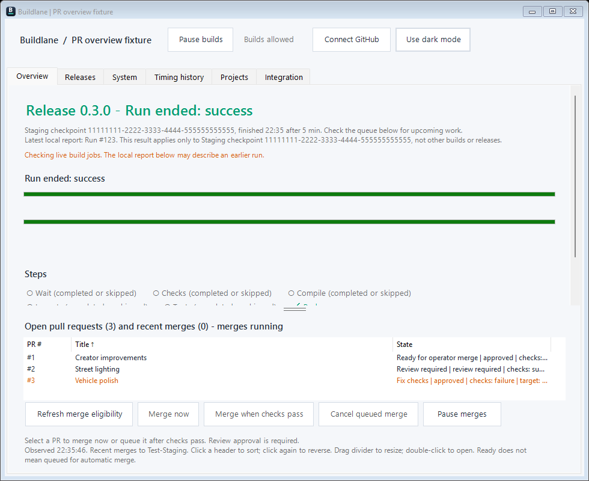
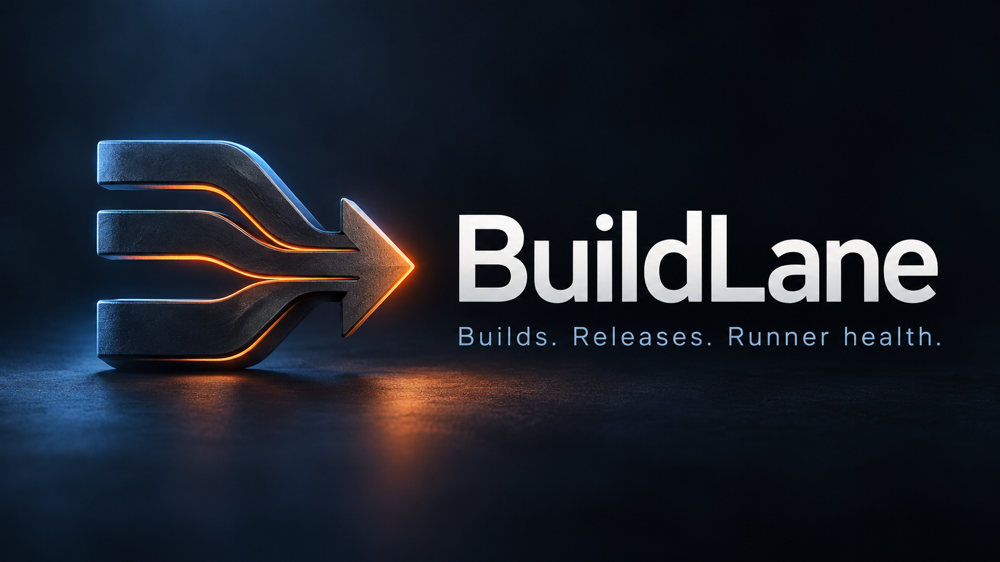
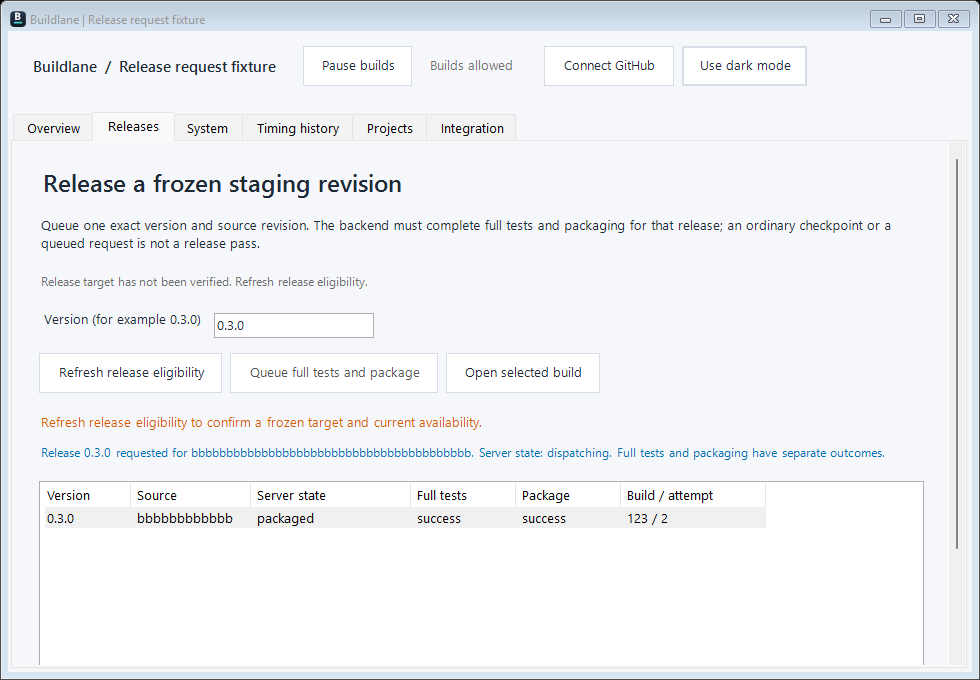

<p align="center">
  
</p>

<h1 align="center">BuildLane</h1>

<p align="center"><strong>Watch the build, land the changes, ship the release — from one window.</strong></p>

BuildLane is a small Windows app for a self-hosted build lane. It shows what the PC is building right now, which
changes are waiting, and which release is next, so you do not have to keep a PowerShell window open or watch GitHub
in a browser tab.



Made by Stonefletcher Productions LLC. The source is available in this repository.

**Jump to:** [Install](#install) · [First five minutes](#first-five-minutes) · [The tabs](#the-tabs) · [Everyday tasks](#everyday-tasks) · [Where settings live](#where-your-settings-live) · [Something looks wrong](#if-something-looks-wrong) · [Developers](#for-developers)

## Refreshed visuals



[Fresh interface capture and image sources](marketing/refresh/README.md). Real Windows Forms interface rendered by app/PreviewDocs.ps1 with synthetic project data; not live project results.

## What it does

- **Shows the truth about the current build** — which step, how far through, how long it has been running, and the
  exact run it belongs to. A green test run never makes an unreported Package step look finished.
- **Updates without flashing** — unchanged status leaves overview text, row visibility and layout untouched while live polling continues.
- **Keeps open PRs visible after builds finish** — independently reads paginated GitHub PRs and recent merges to the integration branch. Groups them by what they need (queued to merge, needs you, ready, waiting for review) under a one-line summary that keeps merge and build pauses apart; recent merges are hidden until asked for. Results refresh every 30 seconds and retain clearly marked last-known evidence on errors.
- **Merges reviewed changes through the controller** — select a PR, refresh merge eligibility, then merge now or queue that exact head until checks pass. Cancel queued merge removes that request without cancelling a build. Missing review, stale data and unsupported backends keep controls disabled.
- **Sorts the queue by PR #, Title, or State** - click a column header to sort ascending, then click again for descending. The arrow shows the direction, and the display keeps its order as PRs refresh.
- **Shows the queue in human words** — "Waiting for v0.2.6 to finish", "held: main is red", "waits for the next batch:
  it conflicts with #408". Waiting is grey; a real blocker is orange; work in progress is blue.
- **Pauses builds on this PC** — including the option to stop the build already running. The hosted merge queue has separate **Pause merges / Resume merges** controls with confirmed server state.
- **Handles releases** — validation-first projects keep milestone release queues. Staging projects queue an exact
  version and frozen source through the controller, with separate full-test and package results tied to a build attempt.
- **Moves pull requests in bulk**, in the background, and keeps the ones that failed selected so you can retry.
- **Reports the server's integration mode** — validation before merge or reviewed merges to Test-Staging followed by
  explicit build checkpoints. Mode changes require fresh backend eligibility and confirmed server readback.
  Full release tests and packaging remain mandatory in both modes.
- **Keeps several projects apart** — each with its own repository, runner paths and credentials.
- **Runs your GitHub Actions workflows on this PC** — the [local runner](runner/README.md) watches GitHub, runs the repository's own workflow files here and reports commit statuses back, so the project no longer needs GitHub-hosted Actions.
- **Remembers how you left it** — window size, divider positions, light or dark, last project.

## See it

<p>
  
  
</p>

Left: **Releases in staging mode** — a versioned request with separate Full tests and Package results. Right: the
Overview in **dark mode**. These are real app screens with synthetic fixture data, not live project results.
See [screenshot provenance](docs/images/README.md). The [milestone release screen](docs/images/releases.png) remains available in validation-first mode.

BuildLane is a front end for a build system you already have. It does not create a runner, and it does not supply a
CI pipeline: your runner writes a small status file and the app draws it. See
[Connect your build system](docs/INTEGRATION.md) for that contract.

## Install

**You need:** Windows 10 or 11, Windows PowerShell 5.1 (already installed), and the .NET Framework compiler that ships
with Windows. GitHub CLI is optional — the app also accepts a GitHub token.

1. **Get the code.** Clone the repository, or use **Code → Download ZIP** and extract it.
2. **Open Windows PowerShell in that folder.** In Explorer, shift-right-click the folder and choose *Open PowerShell
   window here*, or `cd` into it.
3. **Run the installer:**

   ```powershell
   powershell.exe -NoProfile -ExecutionPolicy Bypass -File .\app\InstallLaneApp.ps1
   ```

4. **Open BuildLane** from the new desktop icon. The PowerShell window that started it can be closed.


The app installs into `%LOCALAPPDATA%\Programs\Buildlane`. Upgrading keeps your saved projects; a new install starts on
a neutral setup screen. The optional [LifeShare example profile](examples/LifeShare.profile.json) can be imported if you
want to see a filled-in project.

The [illustrated setup guide](docs/GETTING-STARTED.md) explains every field, switching projects and sharing profiles.

## First five minutes

The setup screen walks the same three steps the app shows at the top:

1. **Choose a repository.** Paste the GitHub URL — `https://github.com/acme/desktop` — not the `git@` clone URL. The
   app stores `acme/desktop`.
2. **Point to your runner.** Three paths, all on the machine that builds:
   - *Status file* — what the runner writes while it works, e.g. `C:\BuildRunner\Acme\status.json`
   - *Pause file* — the app creates this file when you press **Pause builds**, e.g. `C:\BuildRunner\Acme\PAUSED`
   - *Runner folder* — the lane's working folder, used for disk checks and the log helpers
3. **Save and use**, then **Connect GitHub**. The app uses your `gh` CLI login if it has one, otherwise paste a token.
   The token is encrypted with Windows DPAPI and stored for your Windows user only.

Press **Refresh** on Releases and the tab fills in. If the status file is missing, Overview says *No build has
reported yet* — that is a path problem, not a crash.

## The tabs

| Tab | What you do there |
|---|---|
| **Overview** | The live picture: the build, its step, both progress bars, the steps so far, and the queue. Buttons open the live log, the status page, and the step log. Drag the marked dividers to resize the queue, step log and release lists; their sizes are remembered. |
| **Releases** | In staging mode, enter a version, refresh eligibility, then queue full tests and a package of the frozen staging revision. In validation-first mode, manage milestone releases and their pull requests. |
| **Integration** | Read the confirmed server mode, change it when eligible, or request a staging checkpoint. A checkpoint is separate from a packaged release. |
| **Timing history** | Job and step times for reported runs, with source commit, attempt and result. Failed and cancelled attempts stay visible. |
| **System** | Runner health: free disk, cache size, the services the lane needs. Read-only. |
| **Projects** | The project editor: add, edit, import and export profiles, and switch which project is on screen. |

## Everyday tasks

| I want to… | Do this |
|---|---|
| Stop new builds starting | **Pause builds**. If something is building, it asks whether to stop that too. |
| Let builds run again | **Resume builds** permits new work; it does not request a checkpoint or package. |
| Package staging | Releases → enter a version → **Refresh release eligibility** → **Queue full tests and package**. Follow the selected request through separate Full tests and Package results. |
| Validate a staging checkpoint | Integration → **Refresh backend eligibility** → **Request checkpoint**. This does not replace a release's full tests and package. |
| Ship a milestone release in validation-first mode | Releases → pick it → **▶ Queue release build**. The configured backend handles that release's ready pull requests and packaging. |
| See when a milestone release ships | In validation-first mode, the release row shows `queued: ships by HH:MM`. |
| Move changes to another milestone release | In validation-first mode, tick them in the pull request list, pick a release, press **Move**. |
| Check why a build failed | Overview → **Open live log** (GitHub) or **Show step log** (the step's log in the window). |
| Switch project | Projects → **Use selected**. |
| Change the look | **Use dark mode** / **Use light mode** in the top bar. |

For the complete staging flow and how to find the resulting package, see [Build and release from staging](docs/RELEASING.md).

Resume and stop requests show pending feedback immediately while GitHub responds in the background. A request
accepted by GitHub does not mean a build has started: the app shows the latest observed lane controller separately
from the runner's status report. An uncertain response asks you to check GitHub before retrying; commands are never
automatically resent. Project switching and overlapping writes are blocked while a lane request is in flight.

Local reports refresh every second, releases every 15 seconds while their tab is open, and machine health is checked
in the background every 30 seconds. GitHub reads are coalesced and respect retry delays. The app cannot show a phase
before the runner writes it; the report timestamp and run identity remain visible. Release creation, queue preparation, milestone changes, and connection verification also run in the background.
Confirmed partial writes remain visible after a failure; uncertain writes are never automatically retried.

The Overview shows the runner's waiting reason, detail, and blocking run when reported. If the backend has not
provided a reason, the app says so. It does not infer that a package or another PR is blocking the current run.

**Timing history** loads GitHub jobs and step durations for run IDs reported by this project. It retains the last
20 completed attempts locally, including failures and cancellations, with source commit and attempt identity.
Select a run to inspect individual steps; skipped steps have no execution duration. Parallel job durations are not
summed into wall time. History is collected as runs are encountered, rather than backfilling the repository; a
successful entry does not certify another build or release. A rerun's waiting time excludes the gap since the
original run was created. Reads share one background worker and respect retry delays; timings refresh no more than
once every 30 seconds. No build is launched by viewing history.

Projects can configure **Active build jobs** as exact workflow/job pairs, for example
`ci.yml|Build and test;compile-preview.yml|Compile only (not release validation)`. The app then observes those GitHub
jobs automatically, independently of local button clicks, every 15 seconds. It shows queued/preparing work before
the next runner report arrives and keeps the prior local result separately. Quick-check-only workflows are excluded.
Queue length stays unknown until the current run reports it; a previous run's zero is not reused. Live-log links
follow the displayed run and attempt. API errors or old observations are labeled unconfirmed, and newer runner
reports take precedence over older GitHub evidence. Old profiles without the optional setting retain local reporting.

## Where your settings live

| What | Where |
|---|---|
| The app | `%LOCALAPPDATA%\Programs\Buildlane` |
| Projects and window layout | `%APPDATA%\Buildlane\Projects` (`default.json`, `current.txt`, `layout.txt`) |
| Timing history | `%APPDATA%\Buildlane\Projects\timings-<project-key>.json` (20 completed attempts per profile) |
| GitHub token (DPAPI-encrypted) | `%APPDATA%\Buildlane\<owner_repo>\github.token` |
| Runner helpers | `%LOCALAPPDATA%\Buildlane\Runner` |

Delete a project's token file to sign out of it. Nothing is written into the installation folder, so reinstalling
keeps your projects.

## If something looks wrong

- **"No build has reported yet"** — the status file path does not match what your runner writes. Check the path in
  Projects.
- **"No update from the build for 10 min"** — the app has the file but nothing has touched it. The build may be stuck;
  open the live log.
- **"Step 1 of 1" while a build is running** — something other than the lane wrote the status file (a pull request's
  quick checks, for example). The app falls back to the standard six steps rather than showing a fake one-step job.
- **A field is greyed out** — Overview, Releases and System are disabled until a project is saved.
- **The window opened small** — it remembers its size. Drag it larger; the new size is kept.

More, including the message you get when GitHub rate-limits the app: [Troubleshooting](docs/TROUBLESHOOTING.md).

## For developers

Run from the repository root (Windows PowerShell, not PowerShell 7):

```powershell
powershell.exe -NoProfile -STA -ExecutionPolicy Bypass -File .\app\TestLaneApp.ps1
powershell.exe -NoProfile -STA -ExecutionPolicy Bypass -File .\app\TestLaneGitHub.ps1
powershell.exe -NoProfile -STA -ExecutionPolicy Bypass -File .\app\TestLaneOnboarding.ps1
powershell.exe -NoProfile -STA -ExecutionPolicy Bypass -File .\app\TestLaneMoves.ps1
powershell.exe -NoProfile -STA -ExecutionPolicy Bypass -File .\app\TestLaneFeedback.ps1
powershell.exe -NoProfile -STA -ExecutionPolicy Bypass -File .\app\TestLaneActions.ps1
powershell.exe -NoProfile -STA -ExecutionPolicy Bypass -File .\app\TestLaneHistory.ps1
powershell.exe -NoProfile -STA -ExecutionPolicy Bypass -File .\app\TestLaneActivity.ps1
powershell.exe -NoProfile -STA -ExecutionPolicy Bypass -File .\app\TestLaneResources.ps1
powershell.exe -NoProfile -STA -ExecutionPolicy Bypass -File .\app\TestLaneProcesses.ps1
```

They use temporary profiles and mocked GitHub responses, and GitHub Actions runs the same checks on Windows. Nothing
touches a real project. [CONTRIBUTING.md](CONTRIBUTING.md) covers the layout, the optional live check and how to
regenerate the screenshots in this README:

```powershell
powershell.exe -NoProfile -STA -ExecutionPolicy Bypass -File .\app\PreviewDocs.ps1 -OutDirectory .\docs\images
powershell.exe -NoProfile -STA -ExecutionPolicy Bypass -File .\app\TestLaneOnboarding.ps1 -PreviewDirectory .\docs\images
```

Both render the real interface with synthetic data — no network, no saved projects.

**Installer.** MSI packaging is available for testing:
`.\app\BuildLaneInstaller.ps1 -Version 1.2.0` writes an unsigned MSI to `%LOCALAPPDATA%\Buildlane-Packages`. Signing
credentials are pending and the latest MSI still needs a clean install/upgrade/uninstall pass, so the direct
installation command above is the supported route. See [packaging](docs/PACKAGING.md).

## What BuildLane is not

- **Not cross-platform.** Windows desktop only, and the launcher runs on Windows PowerShell 5.1.
- **Not a CI system.** It reads and drives a lane you already run. The local status and pause controls need the
  [backend contract](docs/INTEGRATION.md); a GitHub connection alone does not make an arbitrary workflow compatible.
- **Not a universal adapter.** Each build system needs a small adapter.
- **Not finished.** GitHub Enterprise Server endpoints are not configurable yet. Waiting detail depends on the
  backend, and timing history requires GitHub access to the reported run.

Related reading: [shared build resources and reservations](docs/RESERVATIONS.md),
[cancelled builds and leftover processes](docs/CANCELLATION.md).

The app was originally extracted from LifeShare commit `55130dbe42ed7b77b996bec051a2f7852b9b91d0`; this repository
holds the standalone app, its tests and its packaging source.

Live build status gives active native jobs priority over old local reports. Exact completed run/attempt evidence clears stale running progress; an unverified old report is labelled unconfirmed, never successful.
