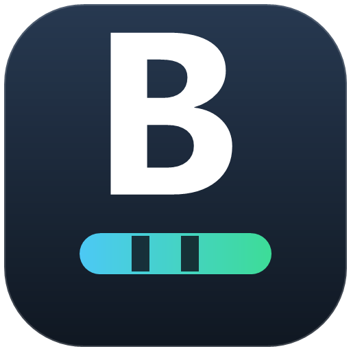
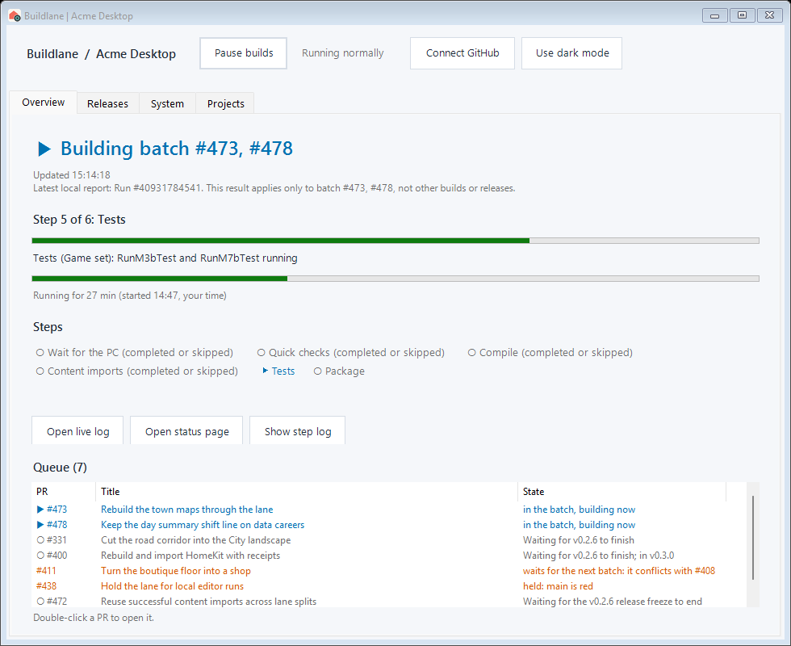
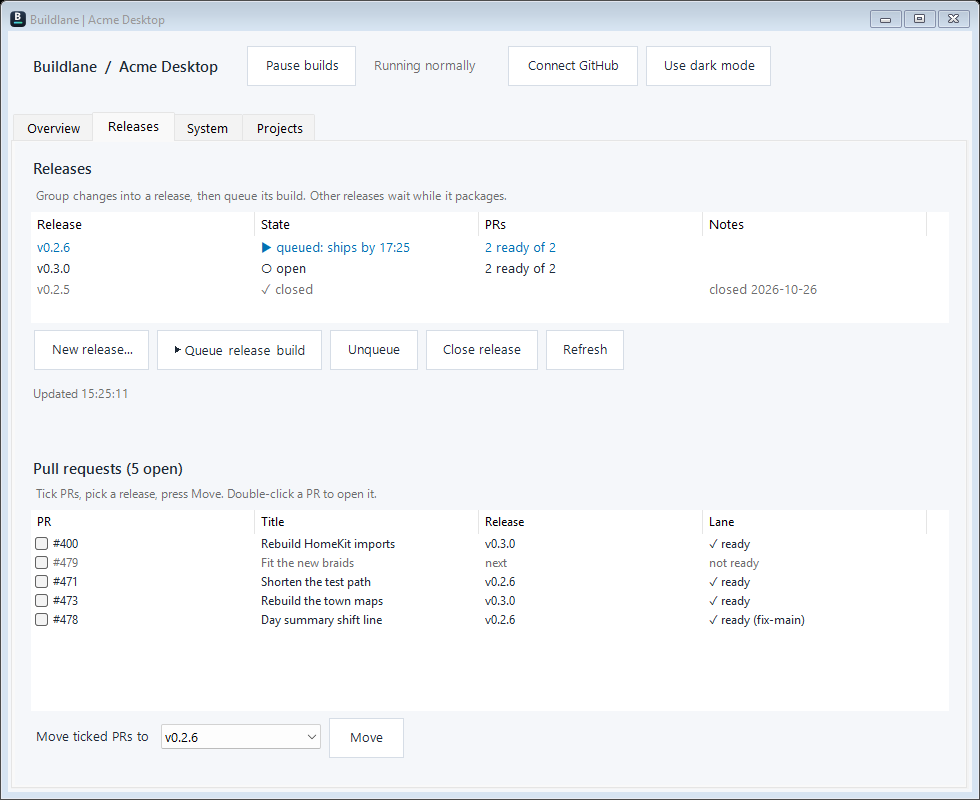
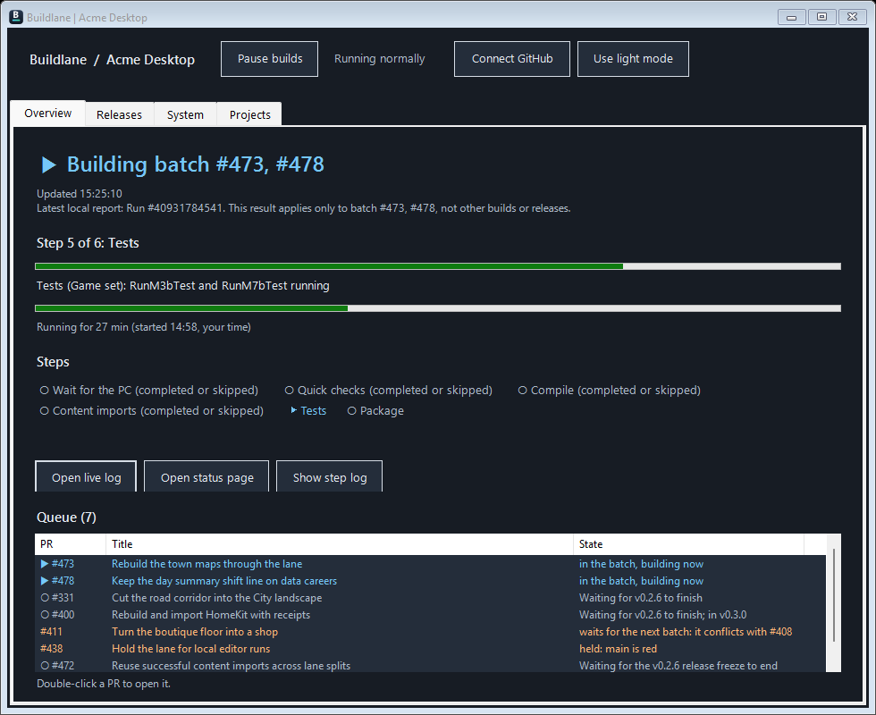
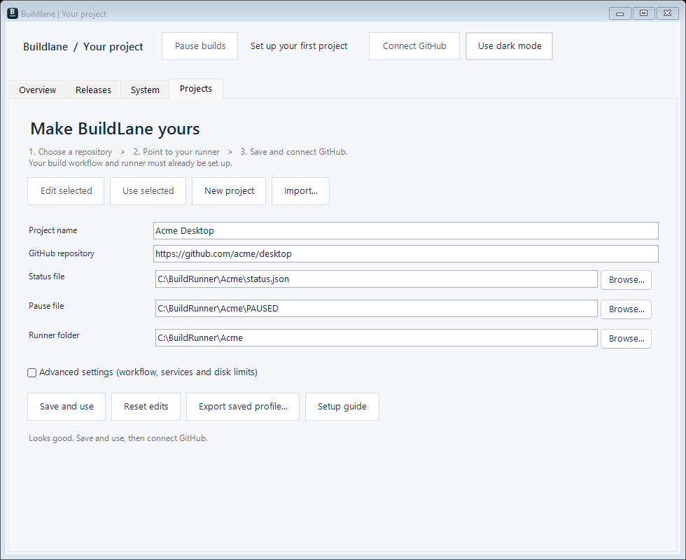

<p align="center">
  
</p>

<h1 align="center">BuildLane</h1>

<p align="center"><strong>Watch the build, land the changes, ship the release — from one window.</strong></p>

BuildLane is a small Windows app for a self-hosted build lane. It shows what the PC is building right now, which
changes are waiting, and which release is next, so you do not have to keep a PowerShell window open or watch GitHub
in a browser tab.



Made by Stonefletcher Productions LLC. The source is available in this repository.

**Jump to:** [Install](#install) · [First five minutes](#first-five-minutes) · [The four tabs](#the-four-tabs) · [Everyday tasks](#everyday-tasks) · [Where settings live](#where-your-settings-live) · [Something looks wrong](#if-something-looks-wrong) · [Developers](#for-developers)

## What it does

- **Shows the truth about the current build** — which step, how far through, how long it has been running, and the
  exact run it belongs to. A green test run never makes an unreported Package step look finished.
- **Shows the queue in human words** — "Waiting for v0.2.6 to finish", "held: main is red", "waits for the next batch:
  it conflicts with #408". Waiting is grey; a real blocker is orange; work in progress is blue.
- **Pauses everything** — including the option to stop the build that is already running.
- **Handles releases** — group pull requests into a release, queue its package build, and see the cut time it has to
  ship by.
- **Moves pull requests in bulk**, in the background, and keeps the ones that failed selected so you can retry.
- **Keeps several projects apart** — each with its own repository, runner paths and credentials.
- **Remembers how you left it** — window size, divider positions, light or dark, last project.

## See it

<p>
  
  
</p>

Left: **Releases** — a queued release says when it has to ship, and pull requests can be moved in bulk. Right: the same
dashboard in **dark mode**.

BuildLane is a front end for a build system you already have. It does not create a runner, and it does not supply a
CI pipeline: your runner writes a small status file and the app draws it. See
[Connect your build system](docs/INTEGRATION.md) for that contract.

## Install

**You need:** Windows 10 or 11, Windows PowerShell 5.1 (already installed), and the .NET Framework compiler that ships
with Windows. GitHub CLI is optional — the app also accepts a GitHub token.

1. **Get the code.** Clone the repository, or use **Code → Download ZIP** and extract it.
2. **Open Windows PowerShell in that folder.** In Explorer, shift-right-click the folder and choose *Open PowerShell
   window here*, or `cd` into it.
3. **Run the installer:**

   ```powershell
   powershell.exe -NoProfile -ExecutionPolicy Bypass -File .\app\InstallLaneApp.ps1
   ```

4. **Open BuildLane** from the new desktop icon. The PowerShell window that started it can be closed.



The app installs into `%LOCALAPPDATA%\Programs\Buildlane`. Upgrading keeps your saved projects; a new install starts on
a neutral setup screen. The optional [LifeShare example profile](examples/LifeShare.profile.json) can be imported if you
want to see a filled-in project.

The [illustrated setup guide](docs/GETTING-STARTED.md) explains every field, switching projects and sharing profiles.

## First five minutes

The setup screen walks the same three steps the app shows at the top:

1. **Choose a repository.** Paste the GitHub URL — `https://github.com/acme/desktop` — not the `git@` clone URL. The
   app stores `acme/desktop`.
2. **Point to your runner.** Three paths, all on the machine that builds:
   - *Status file* — what the runner writes while it works, e.g. `C:\BuildRunner\Acme\status.json`
   - *Pause file* — the app creates this file when you press **Pause builds**, e.g. `C:\BuildRunner\Acme\PAUSED`
   - *Runner folder* — the lane's working folder, used for disk checks and the log helpers
3. **Save and use**, then **Connect GitHub**. The app uses your `gh` CLI login if it has one, otherwise paste a token.
   The token is encrypted with Windows DPAPI and stored for your Windows user only.

Press **Refresh** on Releases and the tab fills in. If the status file is missing, Overview says *No build has
reported yet* — that is a path problem, not a crash.

## The four tabs

| Tab | What you do there |
|---|---|
| **Overview** | The live picture: the build, its step, both progress bars, the steps so far, and the queue. Buttons open the live log, the status page, and the step log. Drag the marked dividers to resize the queue, step log and release lists; their sizes are remembered. |
| **Releases** | Milestones become releases. Queue a release build, unqueue or close it, and see which pull requests are in it. Tick pull requests and move them to another release in one go. |
| **System** | Runner health: free disk, cache size, the services the lane needs. Read-only. |
| **Projects** | The project editor: add, edit, import and export profiles, and switch which project is on screen. |

## Everyday tasks

| I want to… | Do this |
|---|---|
| Stop new builds starting | **Pause builds**. If something is building, it asks whether to stop that too. |
| Let builds run again | **Resume builds** — the same button. |
| Ship a release | Releases → pick it → **▶ Queue release build**. It lands that release's ready pull requests first, then packages. |
| See when a queued release ships | The release row shows `queued: ships by HH:MM`. |
| Move changes to another release | Tick them in the pull request list, pick a release, press **Move**. |
| Check why a build failed | Overview → **Open live log** (GitHub) or **Show step log** (the step's log in the window). |
| Switch project | Projects → **Use selected**. |
| Change the look | **Use dark mode** / **Use light mode** in the top bar. |

## Where your settings live

| What | Where |
|---|---|
| The app | `%LOCALAPPDATA%\Programs\Buildlane` |
| Projects and window layout | `%APPDATA%\Buildlane\Projects` (`default.json`, `current.txt`, `layout.txt`) |
| GitHub token (DPAPI-encrypted) | `%APPDATA%\Buildlane\<owner_repo>\github.token` |
| Runner helpers | `%LOCALAPPDATA%\Buildlane\Runner` |

Delete a project's token file to sign out of it. Nothing is written into the installation folder, so reinstalling
keeps your projects.

## If something looks wrong

- **"No build has reported yet"** — the status file path does not match what your runner writes. Check the path in
  Projects.
- **"No update from the build for 10 min"** — the app has the file but nothing has touched it. The build may be stuck;
  open the live log.
- **"Step 1 of 1" while a build is running** — something other than the lane wrote the status file (a pull request's
  quick checks, for example). The app falls back to the standard six steps rather than showing a fake one-step job.
- **A field is greyed out** — Overview, Releases and System are disabled until a project is saved.
- **The window opened small** — it remembers its size. Drag it larger; the new size is kept.

More, including the message you get when GitHub rate-limits the app: [Troubleshooting](docs/TROUBLESHOOTING.md).

## For developers

Run from the repository root (Windows PowerShell, not PowerShell 7):

```powershell
powershell.exe -NoProfile -STA -ExecutionPolicy Bypass -File .\app\TestLaneApp.ps1
powershell.exe -NoProfile -STA -ExecutionPolicy Bypass -File .\app\TestLaneGitHub.ps1
powershell.exe -NoProfile -STA -ExecutionPolicy Bypass -File .\app\TestLaneOnboarding.ps1
powershell.exe -NoProfile -STA -ExecutionPolicy Bypass -File .\app\TestLaneMoves.ps1
powershell.exe -NoProfile -STA -ExecutionPolicy Bypass -File .\app\TestLaneResources.ps1
powershell.exe -NoProfile -STA -ExecutionPolicy Bypass -File .\app\TestLaneProcesses.ps1
```

They use temporary profiles and mocked GitHub responses, and GitHub Actions runs the same checks on Windows. Nothing
touches a real project. [CONTRIBUTING.md](CONTRIBUTING.md) covers the layout, the optional live check and how to
regenerate the screenshots in this README:

```powershell
powershell.exe -NoProfile -STA -ExecutionPolicy Bypass -File .\app\PreviewDocs.ps1 -OutDirectory .\docs\images
powershell.exe -NoProfile -STA -ExecutionPolicy Bypass -File .\app\TestLaneOnboarding.ps1 -PreviewDirectory .\docs\images
```

Both render the real interface with synthetic data — no network, no saved projects.

**Installer.** MSI packaging is available for testing:
`.\app\BuildLaneInstaller.ps1 -Version 1.2.0` writes an unsigned MSI to `%LOCALAPPDATA%\Buildlane-Packages`. Signing
credentials are pending and the latest MSI still needs a clean install/upgrade/uninstall pass, so the direct
installation command above is the supported route. See [packaging](docs/PACKAGING.md).

## What BuildLane is not

- **Not cross-platform.** Windows desktop only, and the launcher runs on Windows PowerShell 5.1.
- **Not a CI system.** It reads and drives a lane you already run. The local status and pause controls need the
  [backend contract](docs/INTEGRATION.md); a GitHub connection alone does not make an arbitrary workflow compatible.
- **Not a universal adapter.** Each build system needs a small adapter.
- **Not finished.** GitHub Enterprise Server endpoints are not configurable yet, and a few GitHub writes (such as
  queuing a release) can briefly block the window.

Related reading: [shared build resources and reservations](docs/RESERVATIONS.md),
[cancelled builds and leftover processes](docs/CANCELLATION.md).

The app was originally extracted from LifeShare commit `55130dbe42ed7b77b996bec051a2f7852b9b91d0`; this repository
holds the standalone app, its tests and its packaging source.
