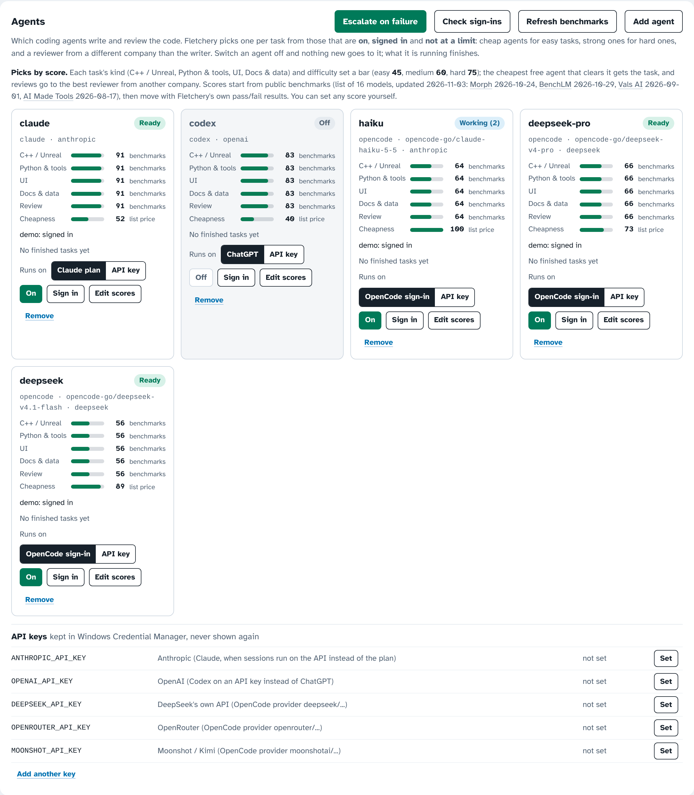

# Coding agents

Fletchery's workers don't have to be Claude. Any task can go to **Claude Code**, OpenAI's **Codex CLI**, or **OpenCode**.
OpenCode reaches DeepSeek, Kimi, GLM, Qwen and many other models, for example on an OpenCode Go plan. Fletchery picks
an agent for each task, has a different company's agent review the work, and hands a failed task to a stronger agent
before it asks you.

<p></p>

## Turning it on

Add an `agents` list and a `routing` block to the project's profile, under `workers`:

```json
"agents": [
  {"name": "claude",       "kind": "claude",   "tier": 4, "vendor": "anthropic"},
  {"name": "codex",        "kind": "codex",    "tier": 3, "vendor": "openai", "enabled": false},
  {"name": "deepseek-pro", "kind": "opencode", "model": "opencode-go/deepseek-v4-pro",     "tier": 2, "vendor": "deepseek"},
  {"name": "deepseek",     "kind": "opencode", "model": "opencode-go/deepseek-v4.1-flash", "tier": 1, "vendor": "deepseek"}
],
"routing": {
  "easy":   ["deepseek", "deepseek-pro"],
  "medium": ["deepseek-pro", "claude", "codex"],
  "hard":   ["claude", "codex"],
  "reviewers": ["claude", "codex"]
}
```

A profile without `agents` runs Claude only, the way Fletchery always has.

| Key | What it means |
|---|---|
| `name` | What Fletchery calls the agent on the dashboard, in logs and in PR bodies; also what `Agent:` lines name |
| `kind` | `claude` (Claude Agent SDK), `codex` (`codex exec`), or `opencode` (`opencode run`) |
| `model` | Empty means the CLI's own default. For OpenCode it is `provider/model`; `opencode models` lists them |
| `tier` | Strength, 1 (cheapest) to 5. A failed task moves up to the next tier that is on |
| `vendor` | The company behind the model. A reviewer always comes from a different vendor than the writer when one is on |
| `enabled` | Off means nothing new goes to it. The **On/Off** switch on the dashboard changes this |
| `maxParallel` | Optional: how many tasks this agent may run at once |
| `keyEnv` | Optional: stored API keys this agent's sessions receive, such as `["DEEPSEEK_API_KEY"]` |
| `auth` | `plan` (default): the CLI's own sign-in (Claude plan, ChatGPT for Codex, OpenCode's sign-in). `key`: the agent's API key from the key store instead, billed per token. Switch it on the agent's card ("Runs on"). |
| `timeoutMinutes` | Optional, for Codex and OpenCode, which have no turn limit: `{"worker": 60, "reviewer": 20}` |

## How a task gets its agent

1. **You asked for one.** An `agent:codex` label, or a line `Agent: deepseek` in the issue body, wins. If that agent
   is off, paused or busy, the task waits and says so in the queue. It doesn't go to a different agent.
2. **Difficulty.** A `difficulty:easy|medium|hard` label or a `Difficulty:` line wins. Otherwise Fletchery reads the
   issue:
   - **Hard** at 3 points or more. Saves and migrations are worth 3, multiplayer races and threading 2. A mention of
     replication, navmesh or NavCheck, `Lane-Imports:`, Folk autonomy, profiling or a refactor is worth 1 each,
     because LifeShare issues name those as proof steps almost every time. A very long issue or four or more C++
     files add 2, and three or more dependencies add 1.
   - **Easy:** nothing scored, and the issue is about docs, typos or wording, string tables, tests only, comments or
     logging, or a small Python tool, with no C++ files and a short body.
   - **Medium:** everything else.

   To change the patterns, set `routing.hardPatterns` (`[regex, weight]` pairs), `routing.easyPatterns` and
   `routing.hardScore`.
3. **The list for that difficulty**, filtered to the agents that are **on**, **signed in**, **not paused for a limit**
   and **below their `maxParallel`**. When the first choice isn't available, the next one takes the task. Agents not
   in the list come after it, strongest first.
4. **Learning.** Every attempt is recorded in the ledger with its agent and difficulty. Once a cheaper agent has passed
   at least `minSamples` (5) tasks of a difficulty at `promoteAt` (80%) or better, it is tried first for that
   difficulty. An agent that passes fewer than `demoteBelow` (40%) goes to the back. Set `"learn": false` to turn
   this off.

## Scores (routing mode `scores`)

With `"routing": {"mode": "scores"}` (the default when the profile names no per-level lists), each agent has a score from 0 to 100 for five kinds of work (C++ / Unreal, Python & tools, UI, Docs & data, Review) plus **Cheapness**. A task's kind comes from its text (`.cpp`, `Tools/*.py`, UMG, `docs/` and so on), or from a `skill:<kind>` label or a `Skill:` line. With no signs it is `routing.defaultSkill` (`cpp`). Its difficulty sets a bar: easy 45, medium 60, hard 75 (`routing.bars`). The task goes to the **cheapest free agent that clears the bar**. Each session an agent is already running counts 10 points against its cheapness, so work spreads out. If nobody free clears the bar, the strongest free agent gets it. Escalation takes the smallest step up in that kind of work. Reviews go to the best reviewer from another company, at least `routing.reviewMin` (50).

Where a score comes from, strongest first:

1. **You**: set it on the card (Edit scores), saved as `scores` on the agent in the profile.
2. **Fletchery's results**: each pass at a level counts as that level's bar + 15, and each fail as the bar - 25. These results are blended with the seed, which counts as six tasks.
3. **Benchmarks**: `fletchery/model_scores.json` lists public numbers per model, each with its source page and date: Terminal-Bench 4.0 + 25, SWE-bench Pro + 10, and SWE-bench Verified - 30 at half weight. Benchmarks don't split C++ from Python, so every kind starts from the same number. Cheapness comes from the list price per million output tokens.
4. **Strength** (1-5): used when no benchmark names the model, as 20 + 15 × Strength.

**Refresh benchmarks** fetches the newest `model_scores.json` from Fletchery's main branch with `gh` and keeps it in the state folder. To add a model, add its numbers and sources to that file on main.

## Review, escalation and limits

- **Review.** The reviewer comes from another vendor than the writer, chosen from `routing.reviewers` first and then
  the strongest agents, at `reviewMinTier` (2) or above. If no other vendor is on, another agent reviews. If there is
  no other agent at all, a fresh session of the same agent reviews, as with Claude alone.
- **Escalation.** When a worker gives up, makes no commits, can't get the checks to pass, or the reviewer still wants
  changes after one more pass, Fletchery throws that attempt away (`git reset --hard` to the base, in the task's own
  worktree only). The next stronger agent then starts again and is told what went wrong. The task is blocked only after
  the strongest agent has failed too. A reviewer's `escalate` verdict (a person must decide) still blocks straight
  away. **Escalate on failure** on the dashboard turns this off.
- **Fixers.** When the Build Lane sends a PR back, the agent that wrote it fixes it. The second attempt goes one tier
  up.
- **Limits and sign-ins.** A usage limit or a lost sign-in pauses only that agent, for `limitBackoffMinutes`, and its
  task goes back to the queue for another agent. Fletchery stops everything only when no agent is left. Every agent's
  sign-in is checked at start, every 30 minutes, and when you press **Check sign-ins**.

## The Agents panel

- **On / Off** per agent, saved in the profile. At least one agent has to stay on.
- **Status:** Ready, Working (n), Paused until …, Not signed in, Off. It also shows what the sign-in check said, and the
  pass rate by difficulty.
- **Sign in** opens the agent's own sign-in in a console window on the PC: `claude` (then `/login`), `codex login`, or
  `opencode auth login`.
- **Add agent** adds any model OpenCode, Codex or Claude can reach. **Remove** deletes one; use Off to keep its
  settings.
- **API keys** are stored in Windows Credential Manager as `Fletchery/<NAME>`, never in the profile or the repository.
  The panel shows only the last four characters. A session receives a key only if its agent lists it in `keyEnv`
  (`ANTHROPIC_API_KEY` is also what **API key** mode uses). Plans and sign-ins need no key: Claude on a Claude plan,
  Codex on ChatGPT, OpenCode on OpenCode Go.
- Each worker card shows which agent is on the task, and whether it is writing or reviewing. Finished sessions show
  who wrote and who reviewed, and so does every PR body.

## What each agent may do

The same rules apply to every agent:

| Role | Claude | Codex | OpenCode |
|---|---|---|---|
| worker, fixer | edit, git, node, python, read tools; no web | `--sandbox workspace-write` (no network) | edit and bash allowed; web fetch and search denied; nothing outside the worktree |
| reviewer, planner | read only (git diff/log/show, grep) | `--sandbox read-only` | edit denied; bash only for git diff/log/show/status, cat, grep, rg, ls |

Codex's sandbox doesn't let it write the repository's `.git` folder, so it can't commit. Fletchery commits whatever it
leaves in the worktree, which is the same safety net Claude workers have always had. Codex also reads your own
`~/.codex` settings and skills.
