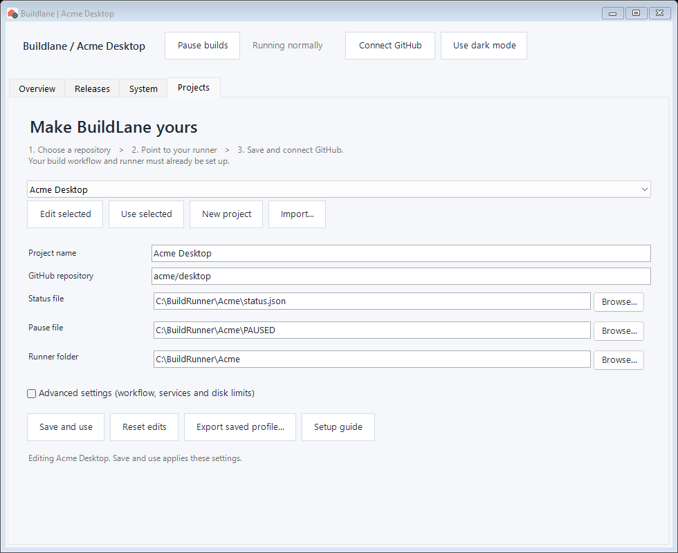

# Get started with BuildLane

## 1. Install and open

Download or clone the repository. In Windows PowerShell, change to that folder and run:

```powershell
powershell.exe -NoProfile -ExecutionPolicy Bypass -File .\app\InstallLaneApp.ps1
```

Open the **Buildlane** desktop shortcut. Installation is per Windows user; it does not install runner services. You can close the installation terminal afterward.

## 2. Add your project

New installations open **Projects**. Existing installations retain their selected project; choose **New project** to add another.


The screen lists the same three steps it asks for: choose a repository, point to your runner, save and connect GitHub. Everything below that is a field in that order.



| Field | What to enter |
| --- | --- |
| Project name | A recognizable name, such as Acme Desktop. |
| GitHub repository | `acme/desktop` or `https://github.com/acme/desktop`. |
| Status file | The JSON file your runner writes as a build progresses. |
| Pause file | The marker file your runner checks before starting work. |
| Runner folder | Your existing build runner folder, including its `_diag/pages` logs if available. |

**Browse** selects an existing folder or a file path. Selecting a status or pause path does not create the file. The prefilled local paths are starting suggestions; change them to match your actual runner. Hover over a field for help.

Expand **Advanced settings** if your branch is not `main`, your workflow is not `lane.yml`, or you need to change service matching, the monitored drive, cache port, or disk thresholds. Set cache port to `0` to turn that check off. These settings describe your backend; they do not install services or enforce cleanup by themselves.

Choose **Save and use**. BuildLane validates the settings and switches to the saved project. Build controls stay disabled during initial setup. Before replacing unsaved edits or closing the app, BuildLane asks whether to discard those edits.

## 3. Connect GitHub

If GitHub CLI is already signed in, BuildLane looks up its token in the background. Otherwise choose **Connect GitHub**, follow the token instructions in the dialog, and paste your token into the masked field. The dialog checks repository access before saving it.

The app's read/write operations need access to the selected repository's Actions, Issues, and Pull requests. An organization may require approval for the token. Repository access validation does not prove every write permission is available; if an action fails, check the permissions and organization policy.

Saved app tokens are encrypted for your Windows user and stored separately from profiles. Do not put a token into a project JSON file. The dialog's **Disconnect** removes the app's saved token; an existing GitHub CLI sign-in can still be used on a later lookup.

## 4. Use the dashboard

| Tab | Use it for |
| --- | --- |
| Overview | Watch the current build, steps, queue, and recent step log. |
| Releases | Refresh GitHub milestones and PRs; manage releases for a compatible lane. |
| System | Check local runner services, drive space, and optional cache endpoint. |
| Projects | Edit, import, export, and switch saved project profiles. |

The Overview tab is split: the build above, the queue below. Drag the divider between them (and between the release list and the pull request list on Releases) to give either side more room; the app remembers those positions, the window size and the light or dark choice. **Use dark mode** / **Use light mode** is in the top bar.

**No build has reported yet** means the configured status file is missing. It is not a GitHub authentication failure. See [integration](INTEGRATION.md) to connect a producer.

Queue colors distinguish normal waiting from problems: **gray** means waiting for a release or a turn, **blue** means active work, and **orange** highlights blockers such as merge conflicts or failing main checks. “Waiting for v0.2.2 to finish” covers both preparation and packaging; it does not imply packaging has already started.

To move multiple PRs, tick them, choose a destination, and press **Move**. Progress appears below the move controls while you can browse other tabs. Project switching, another move, and closing the app wait until the operation finishes. Confirmed moves are unticked; unconfirmed items remain ticked. If notifying the lane fails, the app says so separately from the saved moves.

GitHub refreshes retain the previous results if a request fails or is rate-limited. The Releases message explains when another attempt is available.

## 5. Add or share another project

1. Open **Projects → New project**, fill in its settings, and choose **Save and use**.
2. To switch back, select a saved project and choose **Use selected**.
3. To share the settings, choose **Export saved profile** after saving your edits.
4. On another machine, choose **Import**, select the JSON file, then adjust local paths and choose **Save and use**.

Exports contain project settings, not BuildLane's separately stored token. Review local paths before sharing. The recipient connects their own GitHub account and must already have a compatible runner.

## Where settings live

- App: `%LOCALAPPDATA%\Programs\Buildlane`
- Profiles and selected-project pointer: `%APPDATA%\Buildlane\Projects`
- Encrypted app credentials: `%APPDATA%\Buildlane\<owner_repo>\github.token`

Reinstalling the app preserves saved profiles. Back up the profile folder before changing machines; encrypted tokens must be reconnected on the new machine.
