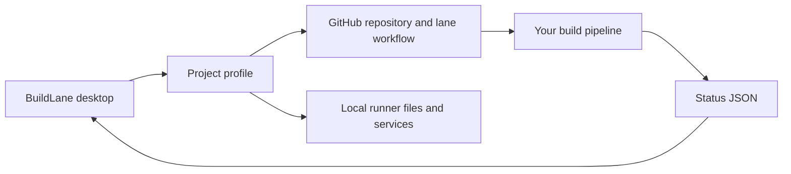

# Connect a build system

BuildLane separates the Windows desktop client from the build backend. A profile tells the client where to look; it does not provision the backend. The [LifeShare profile](../examples/LifeShare.profile.json) is an optional example of an existing integration.



## Local status

Your runner writes the configured `statusFile`. Use ISO 8601 timestamps, and replace the file atomically when possible. BuildLane retains the last valid snapshot if it encounters a partial write.

```json
{
  "updated": "2026-10-26T14:03:00Z",
  "started": "2026-10-26T14:00:00Z",
  "phase": 1,
  "phases": ["Prepare", "Build", "Test", "Package"],
  "what": "Acme Desktop 1.2",
  "step": "Compiling desktop app",
  "progress": { "done": 3, "total": 5 },
  "queue": [{ "number": 42, "title": "Improve welcome screen", "state": "building now" }],
  "notes": [],
  "done": ""
}
```

`phase` is zero-based. Keep `done` empty during work; use `success`, `failure`, or `cancelled` when finished. Optional `runId` supports canceling the associated GitHub Actions run; `runUrl` and `issueUrl` enable log/status links. Recent step logs are read from `<runnerPath>\_diag\pages\*.log`.

The overview is the latest local report, not a release history. Its result applies only to the named build and run ID. The phase cursor does not prove earlier steps ran: earlier phases are marked “completed or skipped,” and later phases “not reported” after completion. In particular, a successful test-only run cannot certify packaging. Release rows independently reflect milestone metadata; they do not fetch or verify the associated Actions run conclusion. Open that release's exact run to distinguish cancellation from failure and confirm the Package step succeeded.

## Pause and resume

The app creates the configured `pauseFile` to request a pause, and removes it to resume. The parent folder must exist and be writable. Your runner must check that marker before starting work. On resume, the app dispatches the lane workflow. BuildLane cannot enforce a pause on a backend that ignores this file.

Pausing also cancels the run that is already in progress, and a queue or release action cancels a batch that is no longer wanted. A cancelled step does not cancel the processes it started: on Windows an editor or commandlet outlives the run, keeps the workspace's output files open, and the next job on that runner fails to write them. Your backend has to end the job's process tree on cancellation, and check before starting that nothing else already has the workspace. [Cancelled builds and leftover processes](CANCELLATION.md) describes the requirement and ships a reference script.

## GitHub workflow and releases

The configured workflow must accept `workflow_dispatch` with `inputs.task = lane` on the configured branch. It must implement the queue/release semantics expected by the app:

- Milestones represent releases; their description contains a line `lane: open`, `lane: queued`, `lane: packaging`, `lane: packaged`, or `lane: failed`.
- A queued release may also carry `lane-deadline: <ISO 8601>`. It is a cut, not an open-ended promise: at that time the backend packages what landed and moves anything still open to the next release. The app shows the local cut time on the release row ("ships by 14:00"), and "cut reached" once it has passed.
- The `ready` and `fix-main` PR labels identify work eligible for the lane.
- Queuing a milestone tells the backend to prioritize its ready PRs, build/package them, and update release state.
- A pull request the backend takes out of the lane leaves its release as well, so a queued release is never blocked by work that cannot land; it joins the next release when it is ready again.
- Integration batches are bounded (a small number of PRs per build) so one failing change cannot hold every other PR in the release.
- Closing or moving a milestone/PR changes GitHub data and can dispatch the lane again.

Do not enable release management against a workflow that does not implement these semantics. The [original LifeShare lane documentation](https://github.com/Stonefletcher-Productions-LLC/LifeShare/blob/main/Docs/BuildLane.md) describes the reference backend; access to that private repository may be required.

## Machine health

The client lists Windows services matching both `actions.runner.*` and the configured `serviceFilter`. Use a project-specific filter. The drive and thresholds control display warnings; your pipeline performs any waits or cleanup. `cachePort` checks whether a local TCP port is listening; `0` disables the check.

A runner service that is running is not the same as a runner that can build: a cancelled job can leave a process behind in the service's session, holding the workspace's output files. BuildLane cannot see or stop it from your desktop session, and its only symptom is the next job failing to link or write. See [Cancelled builds and leftover processes](CANCELLATION.md).

## Profile format

See [the neutral template](../app/BuildLane.profile.json) for field names. `Read-LaneProfile` expands Windows environment variables in the three path fields. The bundled template has `setupRequired: true` to prevent actions before configuration. Profiles saved through the editor omit that setup marker.

Existing profiles without `setupRequired` continue to work. The client currently supports GitHub.com URLs only. Tokens must never be embedded in profiles.
