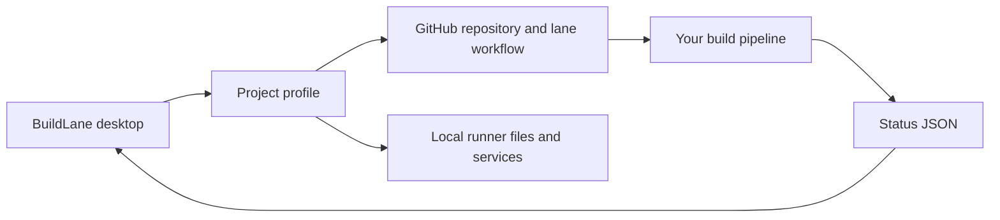

# Connect a build system

BuildLane separates the Windows desktop client from the build backend. A profile tells the client where to look; it does not provision the backend. The [LifeShare profile](../examples/LifeShare.profile.json) is an optional example of an existing integration.



## Local status

Your runner writes the configured `statusFile`. Use ISO 8601 timestamps, and replace the file atomically when possible. BuildLane retains the last valid snapshot if it encounters a partial write.

```json
{
  "updated": "2026-10-26T14:03:00Z",
  "started": "2026-10-26T14:00:00Z",
  "phase": 1,
  "phases": ["Prepare", "Build", "Test", "Package"],
  "what": "Acme Desktop 1.2",
  "step": "Compiling desktop app",
  "progress": { "done": 3, "total": 5 },
  "queue": [{ "number": 42, "title": "Improve welcome screen", "state": "building now" }],
  "notes": [],
  "done": ""
}
```

`phase` is zero-based. Keep `done` empty during work; use `success`, `failure`, or `cancelled` when finished. Optional `runId` supports canceling the associated GitHub Actions run; `runUrl` and `issueUrl` enable log/status links. Recent step logs are read from `<runnerPath>\_diag\pages\*.log`.

The overview is the latest local report, not a release history. Its result applies only to the named build and run ID. The phase cursor does not prove earlier steps ran: earlier phases are marked “completed or skipped,” and later phases “not reported” after completion. In particular, a successful test-only run cannot certify packaging. Release rows independently reflect milestone metadata; they do not fetch or verify the associated Actions run conclusion. Open that release's exact run to distinguish cancellation from failure and confirm the Package step succeeded.

Optional `waitingReason` explains the current wait, `waitingSince` is its ISO 8601 start time, and
`blockingRunId` identifies the reported blocker. These fields are displayed only for unfinished work in
phase zero by default. For waits inside later phases, set `waiting: true` and `waitingPhase` to the current
phase index. A mismatched waitingPhase is stale and is ignored, including during phase zero. Clear waiting
fields when work proceeds. Without
these fields, phase zero uses the existing `detail`/`step` as preparation information, or explicitly says the
reason has not been reported. The app does not infer blockers from
unrelated PR results or milestone states.

Timing history reads `GET /actions/runs/{runId}` and that exact attempt's paginated jobs, recording source SHA,
job/step conclusions and timestamp differences. It retains up to 20 completed attempts per profile, including
cancelled and failed attempts, and keeps in-progress timings in memory. Skipped or missing durations stay
unreported. Before-first-job time is measured from run creation for attempt one, and from GitHub's run-start
timestamp for reruns to exclude time between attempts. Job span covers the earliest start through latest job
completion; overlapping jobs are not summed. Local status remains the authority for the Overview. A successful
history entry does not certify another run or a skipped Package step. No pipeline changes are needed to load
history; the token must be allowed to read Actions runs and jobs.

## Pause and resume

The app creates the configured `pauseFile` to request a pause, and removes it to resume. The parent folder must exist and be writable. Your runner must check that marker before starting work. On resume, the app dispatches the lane workflow. BuildLane cannot enforce a pause on a backend that ignores this file.

Pausing also cancels the run that is already in progress, and a queue or release action cancels a batch that is no longer wanted. A cancelled step does not cancel the processes it started: on Windows an editor or commandlet outlives the run, keeps the workspace's output files open, and the next job on that runner fails to write them. Your backend has to end the job's process tree on cancellation, and check before starting that nothing else already has the workspace. [Cancelled builds and leftover processes](CANCELLATION.md) describes the requirement and ships a reference script.

## GitHub workflow and releases

Release queue preparation is read-only until the user confirms. Before moving each selected PR the client
rechecks that it is open, ready, not a draft, and still unassigned. A change stops remaining moves and queuing,
while confirmed earlier moves remain visible. GitHub does not provide an atomic transaction across this read
and milestone assignment: another client can still change a PR between GET and PATCH. Coordinate release
ownership; these checks reduce stale writes but do not replace backend serialization.

The configured workflow must accept `workflow_dispatch` with `inputs.task = lane` on the configured branch. It must implement the queue/release semantics expected by the app:

- Milestones represent releases; their description contains a line `lane: open`, `lane: queued`, `lane: packaging`, `lane: packaged`, or `lane: failed`.
- A queued release may also carry `lane-deadline: <ISO 8601>`. It is a cut, not an open-ended promise: at that time the backend packages what landed and moves anything still open to the next release. The app shows the local cut time on the release row ("ships by 14:00"), and "cut reached" once it has passed.
- The `ready` and `fix-main` PR labels identify work eligible for the lane.
- Queuing a milestone tells the backend to prioritize its ready PRs, build/package them, and update release state.
- A pull request the backend takes out of the lane leaves its release as well, so a queued release is never blocked by work that cannot land; it joins the next release when it is ready again.
- Integration batches are bounded (a small number of PRs per build) so one failing change cannot hold every other PR in the release.
- Closing or moving a milestone/PR changes GitHub data and can dispatch the lane again.

Do not enable release management against a workflow that does not implement these semantics. The [original LifeShare lane documentation](https://github.com/Stonefletcher-Productions-LLC/LifeShare/blob/main/Docs/BuildLane.md) describes the reference backend; access to that private repository may be required.

## Machine health

The client lists Windows services matching both `actions.runner.*` and the configured `serviceFilter`. Use a project-specific filter. The drive and thresholds control display warnings; your pipeline performs any waits or cleanup. `cachePort` checks whether a local TCP port is listening; `0` disables the check.

A runner service that is running is not the same as a runner that can build: a cancelled job can leave a process behind in the service's session, holding the workspace's output files. BuildLane cannot see or stop it from your desktop session, and its only symptom is the next job failing to link or write. See [Cancelled builds and leftover processes](CANCELLATION.md).

## Profile format

See [the neutral template](../app/BuildLane.profile.json) for field names. `Read-LaneProfile` expands Windows environment variables in the three path fields. The bundled template has `setupRequired: true` to prevent actions before configuration. Profiles saved through the editor omit that setup marker.

Existing profiles without `setupRequired` continue to work. The client currently supports GitHub.com URLs only. Tokens must never be embedded in profiles.

## Automatic active-job observation

Optional `activeJobs` is a semicolon-separated allowlist of `workflow.yml|Exact job display name` entries (at most
eight). It is also editable under Projects > Advanced settings. Include native jobs only, not controllers or quick
checks. The LifeShare example includes `ci.yml|Build and test`, `ci.yml|focused` and the compile-preview native job.
Future workflows must be explicitly added after their job contract is reviewed.

The client reads repository runs in queued/in-progress/waiting states across branches, then fetches jobs for the
exact run attempt and rechecks attempt/source metadata. Only named noncompleted native jobs are eligible; skipped
native jobs in quick-check-only runs do not create active build status. Reads are coalesced with existing GitHub
refresh work, bounded, and back off on failures. More active jobs/pages than can be classified safely produces
unknown status instead of an idle claim. This observer never dispatches, cancels or writes a run/status file.

While a current job is queued/checking out, its identity and observed step supersede an older completed local
report. The earlier result is retained separately. Phase progress is indeterminate and queue count unknown until
that run's local report arrives. Optional local `runAttempt` binds the producer attempt; timestamp freshness also
prevents an earlier attempt's report from being treated as current. A newer local report can supersede an older
API observation. Errors retain last-observed evidence with an explicit unconfirmed label. Run links include the
observed attempt, so a later rerun cannot silently change which evidence opens.

## Server-owned integration mode

Optional profile field `integrationWorkflow` names a controller workflow such as `staging-controller.yml`.
Its trusted dispatch branch is `main`; the backend reports the separate integration branch (`main` or
`Test-Staging`). The Integration tab reads `state.json` at an immutable commit on `lane/staging-state`,
then checks the ref again. Missing, stale, moving or unavailable state disables mode changes.

The app requests a fresh `inspect` before enabling a change. A mode request includes a UUID and the
latest state revision. HTTP acceptance is only pending: the UI requires the matching durable request
binding and actual mode readback before showing success. Uncertain requests are never automatically
resent. The backend must reject changes while work is queued, running, packaging or incompletely
inventoried. Full release tests and packaging remain required in both modes.

In staging mode Resume allows work; reviewed changes go to Test-Staging and native builds require an
explicit checkpoint. Request checkpoint uses a fresh backend `staging.headSha` SHA, explicit boolean
`capabilities.checkpoint`, no `capabilityReasons.checkpoint`, no outstanding work and no local pause.
It sends `details={"target":"<SHA>"}` with the latest state revision. The durable controller record and
matching `state.requests[]` acknowledge the frozen request; only verified `state.checkpoints[]` receipts
can attest validation. A queued request is never shown as a test pass. Legacy release and automatic lane mutations remain disabled in this mode until
the controller supplies their corresponding operations. Use Open controller runs to inspect a request
that is waiting or requires attention.

## Staging release requests

In staging mode the Releases tab uses controller requests instead of milestone-only queue actions.
`inspect` must supply `capabilities.release`, `capabilityReasons.release` and
`releaseTarget.sourceSha`. Queueing sends operation `release`, a fresh UUID, the latest state revision
and `details={"target":"<frozen SHA>","version":"0.3.0"}` to the trusted main controller.

Only a matching completed controller record (including target and version binding) plus the corresponding
versioned `state.requests[]` entry acknowledges the request. HTTP acceptance stays pending and is never
automatically retried. The backend owns cumulative imports, full validation, package generation and
receipt verification. The history reads live versioned `state.requests[]`, not a cached inspection projection, and displays status, Full validation and `package.result` separately;
missing results remain unreported, and skipped packaging never becomes a passed package. Run links use
only the recorded numeric `worker.runId` and `worker.attempt`. The raw `output` and `tree` identify the tested
post-import source separately from the frozen input. Validation-first releases retain their existing UI.
