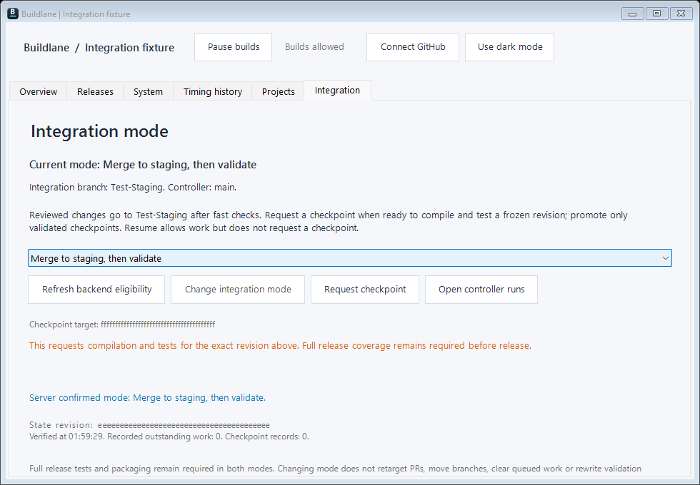

# Build and release from staging

BuildLane supports two integration modes. Your project's backend must support the selected mode; connecting GitHub alone does not configure a build pipeline.

- **Merge to staging, then validate:** reviewed changes pass fast checks and merge to the integration branch. Build at checkpoints, then request full tests and packaging when ready for a release. LifeShare uses `Test-Staging`.
- **Validate before merge:** retain the project's validation-first lane and milestone release queue.

Use **Integration → Refresh backend eligibility** to see the confirmed mode. Choose a different mode and press **Change integration mode** only when available. Wait for server confirmation. Changing mode does not move branches, retarget pull requests, or prove a build passed.

## Get a playable package

1. Finish the reviewed changes intended for the release. In staging mode they belong on the integration branch, not directly on `main`.
2. If the lane is paused, press **Resume builds**. This permits work; it does not itself request a build.
3. Open **Releases**, enter a version such as `0.3.0`, and press **Refresh release eligibility**. Use three numbers without a leading `v` or a preview suffix.
4. Check the displayed staging revision and any waiting reason. Press **Queue full tests and package** when enabled. The request freezes that revision; later staging merges do not silently change this package.
5. Select the request and use **Open selected build** to follow its exact run and attempt. Acceptance or `dispatching` means the request was recorded, not that tests passed. Do not queue it again just because a response is slow.
6. Wait for **Full tests: success**, **Package: success**, and **packaged** on that same request. The details show the tested output and package location when the backend reports them. Open that location on the build PC to find the package; the selected-build button opens GitHub, not the game.

A successful compile preview or checkpoint is not a packaged release. Promotion from staging to `main` is a separate validated backend operation; queuing a package does not certify promotion. A backend may call the worker a “Staging checkpoint” even when it is processing a versioned Full-test/package request: follow the release request's version and exact run.

## Checkpoints between releases

### Merge reviewed PRs from Overview

Select an open PR and press **Refresh merge eligibility**. **Merge now** requires an approved current head, successful checks and clean merge state. **Merge when checks pass** records a durable server queue entry for a reviewed head; the server rechecks approval, checks, conflicts and pause state before attempting a merge. GitHub approval or an exact-head controller review can count; requested changes override prior approval. A new commit requires review of that head.

The row shows the server's queue state and waiting reason. Requests are never resent automatically by the desktop timer. **Cancel queued merge** cancels only the selected queue entry, not a running build. Unsupported controllers, stale observations, drafts and PRs targeting other branches keep merge controls disabled. Double-click a PR to open it for review.

Use **Integration → Refresh backend eligibility → Request checkpoint** to validate the current integration revision without asking for a release. The backend determines checkpoint checks; LifeShare uses its import, compile and game-test checkpoint. Full release tests and packaging remain required in both modes.

## If it appears to stop

- **Paused:** resume the lane, then explicitly request the checkpoint or release you want.
- **Queued or dispatching:** open the selected build. Another job or shared-PC reservation may be ahead of it.
- **Unverified or unreported:** there is not enough matching evidence to declare success. Inspect the exact build instead of assuming a green unrelated run proves the package passed.
- **Uncertain request response:** check the server result before retrying. BuildLane deliberately does not resend requests automatically.
- **Old report still visible:** Overview separates the last local report from freshly observed jobs. A completed old run must not be mistaken for the current build; an unavailable GitHub observation is marked unconfirmed.

## Illustrated controls

Screenshots below are generated by Windows-hosted tests from the real app with synthetic profiles and mocked backend responses. They illustrate controls only. A green fixture is not evidence that LifeShare or any other project passed release validation.

Image provenance and regeneration instructions are in [the screenshot notes](images/README.md).

Optional advisory build/test choices proposed in [PR #18](https://github.com/Stonefletcher-Productions-LLC/BuildLane/pull/18) are separate, unmerged work as of this guide. They are not required for the staging release flow described here.
