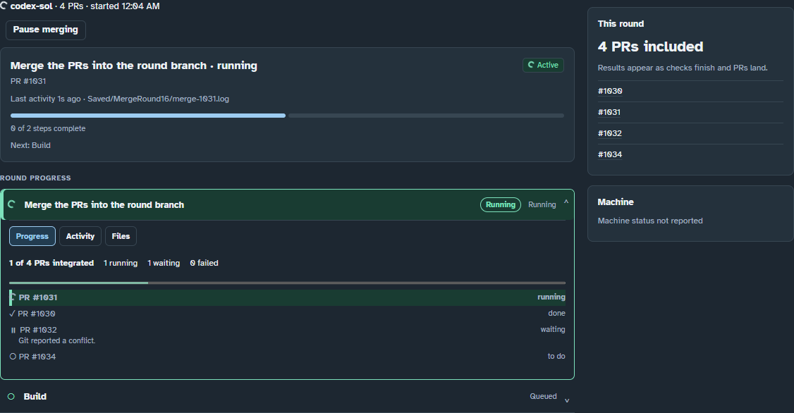
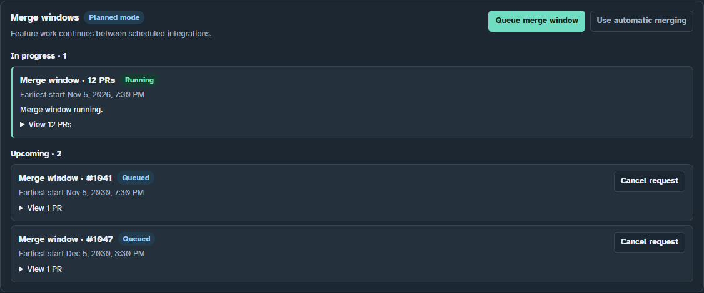

# Plan feature work, merge windows and packages

## Follow work in the dashboard

**Overview** puts **All workers** beside the current merge summary. **Round
details →** opens **Merging** for the full checklist, logs, and scheduled windows.
On a narrow window, the cards stack.

In **Merging**, expand a row under **Round progress**. **Progress** shows the
substeps Fletchery has received. While **Merge the PRs into the round branch**
runs, each PR has its own row and the counter shows how many are integrated.
Running work has a spinner at the round, step, and substep levels. With reduced
motion enabled, the spinner stays still and the text still shows the state.
**Activity** shows recent log lines. **Files** links to available output logs.

Fletchery uses the merge agent's reported substeps when available and reads
the current round's Git logs as a fallback. A reported conflict waits for
resolution. An integrated PR still needs the round's validation before landing.

**Merge windows** groups requests under **In progress**, **Needs attention**,
and **Upcoming**. Upcoming requests show their earliest start, and their PR lists
expand on demand. Open **History** for completed and cancelled requests.
**Cancel request** asks for confirmation. The **Building** view uses the same
grouping for packages.

## Worker capacity

Use **All workers** at the top of Overview to choose 0–30 normal jobs. Changing
that number returns to automatic allocation: Fletchery uses eligible ready tasks,
the existing router, model availability and baseline strength to allocate writing
slots across ranks. Each rank is capped at ten. If no eligible model/task can
use the remaining slots, the panel reports them as unassigned.

The three rank sections show current models, scores, allowed task levels and
active writing sessions. Rank uses the benchmark baseline or configured strength fallback. Learned scores still guide routing within available capacity.

| Rank | Score | Manual capacity |
| --- | --- | --- |
| High | 75–100 | 0–10 |
| Medium | 60–74 | 0–10 |
| Low | Below 60 | 0–10 |

Changing any rank capacity selects manual allocation and sets the total to the
sum of the three capacities. Changing All workers restores automatic allocation.
Lowering capacity never cancels an active session. The task badge records the bucket used at admission, even if an agent escalates or its baseline changes.

Ranks control new writing admission. They do not replace existing task-level,
role, provider, per-model concurrency, sign-in or usage-limit restrictions. Higher
rank models can take easier work when those rules permit it. Existing below-bar
fallback policy is preserved; score rank is not a new difficulty restriction.
Reviews and prerequisite planning keep their existing selection rules. An
already-admitted task may escalate above a rank's configured capacity without
adding another normal job. The independently bounded emergency repair slot is
not charged against these new-writing capacities.

The ready-task counts explain whether easy work actually exists. For example,
an enabled, signed-in DeepSeek model restricted to easy tasks stays idle if no
eligible easy task is ready. Do not manufacture busywork or relabel difficult
work merely to fill a slot.

## Pause and hand off work

**Pause & hand off** stops new worker dispatch. It asks active writers and
fixers to save their checkout at the next safe boundary: checkout preparation,
a finished agent call, completed checks or review. It does not interrupt a
running agent command. Work already opening a PR, or a planner with no writable
checkout, finishes normally.

At a checkpoint Fletchery verifies ownership, stages enumerated tracked changes
and explicitly reported new files, and records the local checkout, HEAD, staged
paths, phase and prior summary. Unrelated untracked or ignored files remain
untouched. Nothing is committed, pushed, reset or deleted by the handoff. A
staging error is shown as preserved work needing inspection, not as a successful
staging result. This is a local checkpoint on the worker machine.

**Resume** lets normal routing choose a worker. It continues in the owned
checkout with the handoff note, inspects staged/unstaged work and runs the usual
checks and review before publishing. Handing off a repair does not consume an
attempt or forget the feedback it still needs to address. Restart distinguishes
a completed checkpoint from a request that never reached its boundary.

## Feature work and planned merge windows

**Use planned windows** stops automatic batch selection while feature work
continues. **Queue merge window** also selects planned mode. Existing automatic
profiles keep their behavior until planned mode is selected.

1. Choose ready PRs from the preview, up to the project's batch limit. Queueing
   records their exact heads and base branch. Later PRs join a later request.
2. Pick a local start time, or leave it blank for now. The stored timestamp
   includes its UTC offset; Fletchery wakes for due windows instead of waiting
   a complete normal polling interval.
3. If merging is paused, use **Resume merging** when those windows should become
   eligible. Queueing never silently clears a merge hold or saved recovery.
4. Before reserving capacity, the scheduler rechecks exact heads and dependencies.
   Changed heads or an ineligible selected candidate block the request and leave
   feature work available. Cancel the request and queue a fresh preview after
   resolving it.
5. An eligible due window drains current sessions, including repairs, then uses
   the existing merger, shared heavy-work reservation and acceptance checks.
   Active jobs are never killed to make the window start.

An unfinished window survives restart as blocked recovery, rather than starting
again against a potentially changed candidate. Use the existing saved-round
recovery controls; never reset a candidate or discard generated content to clear
its state. Explicit saved-round authorization works in planned mode. A landed
round with left-out/deferred work is reported blocked for this request so a
package dependency cannot silently claim the entire selected window landed.

Queued or blocked requests can be cancelled before execution. Running windows
use the existing merge controls and finish safely. **Use automatic merging** is
available after queued/active requests have been completed or cancelled; blocked
history remains visible. Pausing future merges does not stop an active round.

## Package queue

**Queue package** requires a semantic version such as `0.3.7` and one source:

- A full 40-character source commit, or
- A chosen merge-window request. This waits for successful completion, verifies
  its landing PR merged into the expected base, and freezes its merge commit;
  it never substitutes the branch's newer tip or an older playable build.

The package adapter uses the project's existing `staging-controller.yml` on
`main`, with durable state at `lane/staging-state` (schema version 1,
`MergeToStagingThenValidate`). Projects without that controller receive a visible
blocked reason. This adapter does not invoke arbitrary shell commands or bypass
that controller's target eligibility, CAS state revision, full tests, resource
reservation, LFS and artifact validation.

Package requests support the same start-time control. A due package whose source
is ready takes integration priority over a new merge; independent feature
writing continues while it waits for the trusted controller. The controller owns
build serialization and the shared heavy-work reservation. Fletchery does not
launch a second package/build pipeline.

Every request has a persistent UUID. Fletchery saves dispatch intent before
sending and reads back the matching controller receipt. Restart or a timeout
never automatically resends an uncertain dispatch. An unconfirmed submission
stays visible and requires authoritative controller reconciliation; it cannot be
cancelled locally after it may have started remotely. Known rejections/failures
are shown as blocked. Queueing is not a release pass.

Completion requires the matching request ID, input target and version, a verified
full-test receipt, and a successful verified package for the controller's output
revision. Imports may produce an output commit different from the requested
input; both identities remain in the receipt. The queue shows the package path
and build link when reported. Builds still go to the project's configured output
location, such as LifeShare's `E:\lifeshare-scratch\LifeShare-builds`.

## API and validation

Authenticated loopback endpoints are `POST /api/queue/add` (merge or package),
`/api/queue/cancel`, `/api/queue/mode`, `/api/workers` (automatic total) and
`/api/workers/ranks` (manual `low`, `medium`, `high` limits), and
`/api/workers/handoff` (checkpoint and pause). Existing Host and
X-Fletchery-Token protections apply. Status exposes `integration_queue` and
`worker_ranks`; UI controls never imply success before read-back.

Run `python fletchery/test_plans.py`, `python fletchery/test_worker_ranks.py`, the
existing engine/recovery suites and `node ui/test-control-room.cjs`. UI tests use
an isolated headless fixture with synthetic data. To regenerate the screenshots,
run `npm ci --prefix ui` followed by `npm test --prefix ui`. Set
`FLETCHERY_SCREENSHOTS` to choose an output folder. The relevant outputs are
`overview-light.png`, `merge-pr-progress-dark.png`, and `merge-windows-dark.png`.

If an interrupted round lands through a separate recovery, the CLI recovery route can reconcile it using the round number and landing PR. Planned windows or a merge hold must be active. Fletchery verifies the landing branch and every saved PR head with GitHub before clearing recovery.
