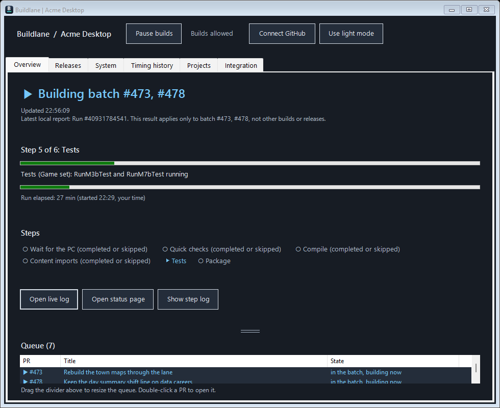

# BuildLane: refreshed imagery

New concept branding and a fresh interface capture or data view, prepared October 29, 2026.

Real Windows Forms interface rendered by app/PreviewDocs.ps1 with synthetic project data; not live project results.

The banner is AI-generated symbolic brand artwork, not a product screenshot or a promise of output quality. The original generated PNG is preserved. [Exact prompt](PROMPT.txt) · [Source revision, input and output fingerprints](provenance.json).

## More fresh interface views

[PR and merge controls](../../docs/images/refresh/open-prs.png) · [Releases](../../docs/images/refresh/releases.png) · [Project setup](../../docs/images/refresh/setup.png) · [Timing history](../../docs/images/refresh/timings.png). These were generated from the current source with isolated synthetic fixtures. PreviewDocs, TestLaneOnboarding and TestLanePullView completed successfully.
